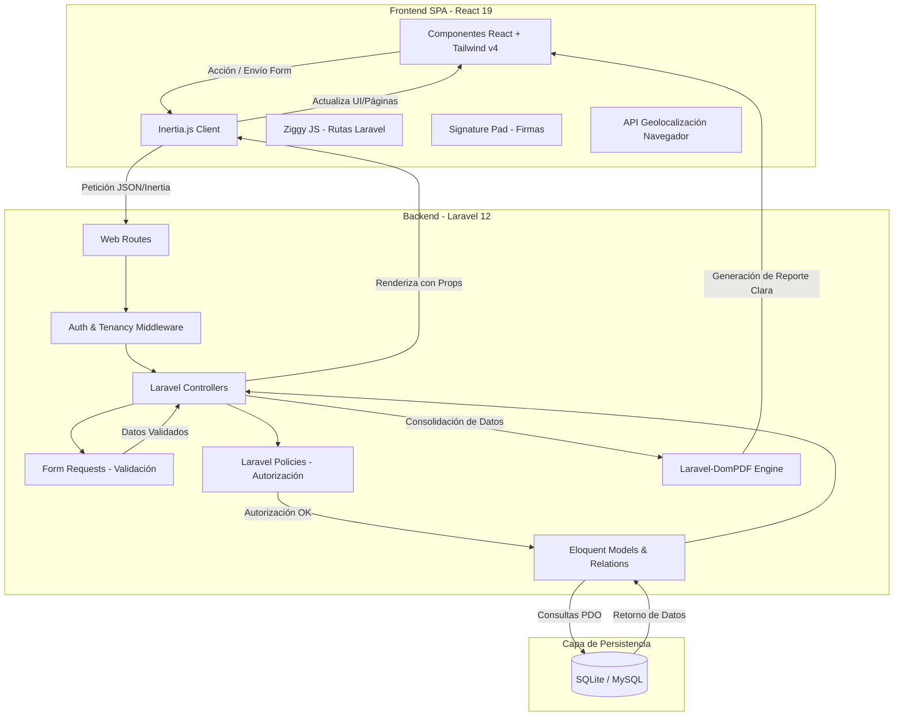

# 🏗️ Arquitectura de Software — XamaSafe (Guía de Referencia para NotebookLM)

Este documento detalla la arquitectura de software de **XamaSafe**, explicando la interacción de componentes, el flujo de datos, algoritmos clave, políticas de seguridad y la estructura de archivos técnicos. Ha sido diseñado para ser cargado en **NotebookLM** u otras IAs para brindarles un entendimiento profundo del sistema a nivel arquitectónico.

---

## 1. 🔍 Arquitectura del Sistema (Vista General)

XamaSafe está construido bajo el patrón de **Monolito Híbrido** utilizando **Laravel 12** en el backend y **React 19** en el frontend, conectados dinámicamente mediante **Inertia.js** (actuando como el puente de enrutamiento y estado sin necesidad de construir una API REST separada).



---

## 2. 🔀 Flujo de Datos e Enrutamiento (Inertia.js + Ziggy)

Inertia.js elimina la necesidad de crear controladores API y estados duplicados. El servidor Laravel maneja las rutas web nativas, realiza la validación, y en lugar de retornar una vista Blade estándar, renderiza una página de React inyectando propiedades directas (`props`).

### 2.1. Ejemplo de Ciclo de Petición/Respuesta
1. **Frontend**: El técnico pulsa "Iniciar Visita". Se invoca la función `post` usando el helper `useForm` de Inertia:
   ```javascript
   import { useForm } from '@inertiajs/react';
   
   const { post, processing } = useForm({
       latitude: coords.latitude,
       longitude: coords.longitude,
   });
   
   const submit = () => {
       post(route('tecnico.visits.store', { sedeId }));
   };
   ```
2. **Ziggy JS**: Traduce la ruta nominal `'tecnico.visits.store'` a su endpoint real URL en el frontend de forma transparente.
3. **Backend**: El `Route` de Laravel redirige al controlador correspondiente:
   ```php
   // routes/web.php
   Route::post('/tecnico/visitas/{sede}', [VisitController::class, 'store'])
       ->name('tecnico.visits.store')
       ->middleware(['auth', 'tenant']);
   ```
4. **Controlador**: Valida la petición a través de un `FormRequest`, verifica autorización usando `Policies`, realiza la lógica y redirige a la vista de "Visita en Progreso" con los nuevos datos del estado en base de datos:
   ```php
   public function store(StoreVisitRequest $request, Sede $sede)
   {
       $this->authorize('visit', $sede); // Multi-tenancy check
       
       $visit = $this->visitService->initialize($sede, $request->validated());
       
       return redirect()->route('tecnico.visits.show', $visit->id)
           ->with('flash', ['message' => 'Visita iniciada con éxito.']);
   }
   ```
5. **Redirección de Inertia**: Inertia detecta la redirección y actualiza dinámicamente las `props` del componente React `Tecnico/Visits/InProgress.jsx` sin recargar la página entera del navegador.

---

## 3. 🛡️ Capa de Aislamiento de Datos (Multi-Tenancy)

El sistema de XamaSafe es rigurosamente multi-inquilino (*multi-tenant*). Los datos se segmentan por **Consultoras**, **Empresas** y **Sedes**. Un usuario técnico o corporativo solo puede interactuar con registros asociados a su alcance autorizado.

### 3.1. Arquitectura Relacional
- **`Consultora`**: Máximo nivel corporativo de administración técnica. Agrupa técnicos y administra sus empresas clientes.
- **`Empresa`**: Cliente comercial de la consultora. 
- **`Sede`**: Plantas físicas o locaciones de la Empresa. El personal y las tareas se programan a nivel de sede.
- **`User` (Roles: `gestor`, `tecnico`, `cliente`)**: 
  - El **Gestor** pertenece a una `Consultora`.
  - El **Técnico** pertenece a una `Consultora` (o puede estar asignado libremente por el administrador).
  - El **Cliente** se asocia a través de `sede_users` a sedes específicas de una `Empresa`.

### 3.2. Mecanismo de Seguridad en Laravel
El aislamiento se implementa en dos niveles:
1. **Middlewares Globales**: Sanitizan peticiones y aseguran sesión activa.
2. **Laravel Policies (`app/Policies/*`)**: Auditan de forma estricta los modelos Eloquent antes de cualquier consulta o mutación.
   ```php
   // Ejemplo en app/Policies/SedePolicy.php
   public function view(User $user, Sede $sede)
   {
       if ($user->rol === 'gestor') {
           return $user->consultora_id === $sede->empresa->consultora_id;
       }
       if ($user->rol === 'cliente') {
           return $user->sedes->contains($sede->id);
       }
       if ($user->rol === 'tecnico') {
           // Verifica si tiene asignaciones de trabajo en esta sede
           return $sede->assignments()->where('user_id', $user->id)->exists();
       }
       return false;
   }
   ```

---

## 4. 📐 Algoritmos Clave y Lógica de Control

### 4.1. Algoritmo de Verificación de Presencia (GPS - Fórmula de Haversine)
Para evitar que un técnico simule visitas o check-ins fuera de planta, el backend compara las coordenadas provistas en tiempo real por el dispositivo con las coordenadas registradas de la Sede.

Se aplica la **Fórmula de Haversine** para calcular la distancia de arco entre dos puntos del globo terráqueo dada su latitud y longitud:

$$\Delta\text{lat} = \text{lat}_2 - \text{lat}_1$$
$$\Delta\text{lon} = \text{lon}_2 - \text{lon}_1$$
$$a = \sin^2\left(\frac{\Delta\text{lat}}{2}\right) + \cos(\text{lat}_1) \cdot \cos(\text{lat}_2) \cdot \sin^2\left(\frac{\Delta\text{lon}}{2}\right)$$
$$c = 2 \cdot \arctan2\left(\sqrt{a}, \sqrt{1-a}\right)$$
$$d = R \cdot c$$

Donde $R = 6,371,000 \text{ metros}$ (Radio medio de la Tierra).

#### Implementación en PHP (Service Layer)
```php
public function calculateDistance(float $lat1, float $lon1, float $lat2, float $lon2): float
{
    $earthRadius = 6371000; // metros

    $latDelta = deg2rad($lat2 - $lat1);
    $lonDelta = deg2rad($lon2 - $lon1);

    $a = sin($latDelta / 2) * sin($latDelta / 2) +
         cos(deg2rad($lat1)) * cos(deg2rad($lat2)) *
         sin($lonDelta / 2) * sin($lonDelta / 2);

    $c = 2 * atan2(sqrt($a), sqrt(1 - $a));

    return $earthRadius * $c; // Distancia en metros
}
```
Si la distancia calculada $d \le \text{radio\_tolerancia\_metros}$ (ej. 500m), el check-in se marca como **Verificado por GPS**. Si es superior, el sistema obliga al técnico a ingresar una justificación para poder continuar.

### 4.2. Lógica del Motor de Fallas en Checklists Dinámicos
Cuando el técnico envía las respuestas (`dynamic_answers`) de un checklist dinámico, el sistema evalúa si las respuestas disparan un estado de **Falla / No Conformidad** de forma automatizada.

```
                  ┌──────────────────────────────┐
                  │      Entrada de Respuesta    │
                  └──────────────┬───────────────┘
                                 │
                   ¿Es una pregunta tipo Number?
                   ├── Sí ──> ¿Está fuera del rango [min_value, max_value]?
                   │           ├── Sí ──> MARCAR FALLA
                   │           └── No  ──> APROBADO
                   │
                   └── No ──> ¿El valor está dentro de `failure_values`?
                               ├── Sí ──> ¿Qué tipo de lógica tiene?
                               │           ├── `fail_if_selected` ──> MARCAR FALLA
                               │           └── `fail_if_missing` (multiselección)
                               │                 ├── ¿Falta algún elemento requerido?
                               │                 │    ├── Sí ──> MARCAR FALLA
                               │                 │    └── No  ──> APROBADO
                               │                 └── APROBADO
                               └── No ──> APROBADO
```

---

## 5. 🖨️ Arquitectura del Motor de Reportes en PDF (DomPDF)

El motor de reportes consolida la información en documentos formales firmados. 

### 5.1. Estrategia del Estilo Dual (HUD vs. Impresión)
- **Interfaz (HUD Premium Dark)**: Estilo inmersivo oscuro (`#11111D`), ideal para reducir fatiga ocular en campo y transmitir innovación.
- **Reportes PDF**: Para los reportes oficiales generados con DomPDF, el sistema aplica una hoja de estilos de contraste inverso (`print.css` u hoja inline inyectada en Blade) que:
  1. Cambia todos los fondos oscuros a blanco absoluto.
  2. Ajusta textos a negro oscuro o grises de alta legibilidad.
  3. Aplica un filtro de inversión cromática a las firmas de base de datos (`brightness-0 invert opacity-90`) para restaurar la tinta oscura original con fondo transparente, evitando parches oscuros pixelados en la hoja de papel.
  4. Agrega quiebres de página automáticos (`page-break-after: always;`) entre las distintas secciones del reporte para que los anexos de firmas e imágenes queden perfectamente diagramados.

---

## 6. 📁 Estructura del Proyecto y Flujos de Archivos Clave

El codebase organiza la lógica del backend por servicios, separando controladores de la lógica pura de negocio:

```
ep-back/
├── app/
│   ├── Http/
│   │   ├── Controllers/       # Controladores de Inertia
│   │   │   ├── Gestor/        # Lógica de administración y consolidación
│   │   │   ├── Tecnico/       # Check-in, ejecución de checklists y firmas
│   │   │   └── Auth/          # Autenticación segura de usuarios
│   │   └── Requests/          # Validaciones (Rules, Haversine bounds, arrays)
│   ├── Models/                # Entidades Eloquent y relaciones relacionales
│   ├── Policies/              # Reglas estrictas de multi-tenancy
│   └── Services/              # Lógica pura (GPS calculador, consolidación mensual)
├── database/
│   ├── migrations/            # Historial de migración SQLite/MySQL
│   └── seeders/               # Datos representativos para demostración local
├── resources/
│   ├── js/
│   │   ├── Components/        # Componentes UI reutilizables (inputs, HUD Cards)
│   │   ├── Layouts/           # Layout Táctico con sidebar y estado de sincronía
│   │   └── Pages/             # Páginas SPA resueltas por Inertia
│   └── views/
│       ├── app.blade.php      # Layout HTML base para montar la SPA React
│       └── pdf/               # Plantillas de impresión con CSS inverso
```

---
*Última actualización de la arquitectura: 24 Mayo 2026*  
*Preparado para el análisis conceptual estructurado de NotebookLM.*  
