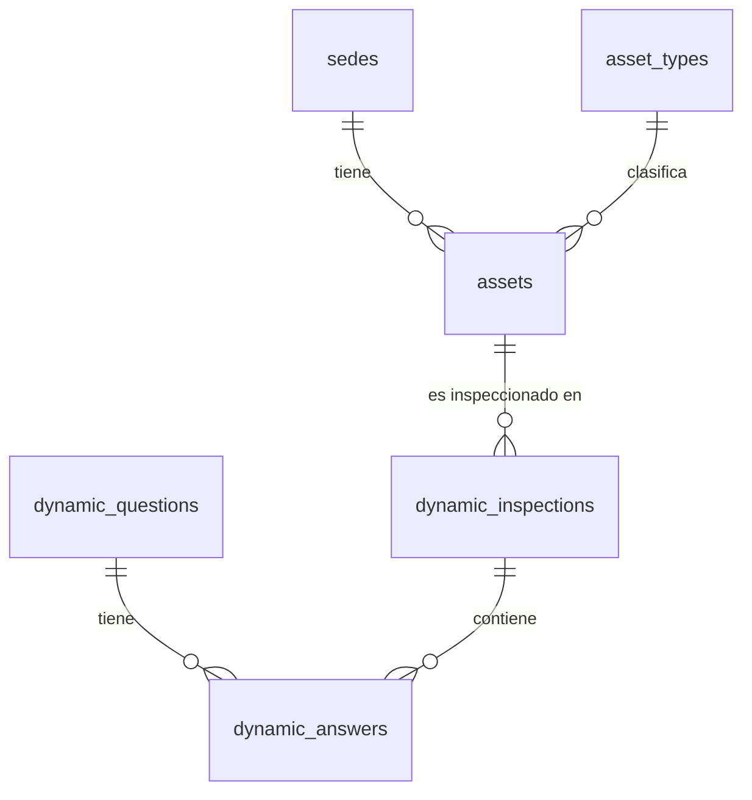

# Módulo Universal de Activos y Trazabilidad Dinámica (Asset-Centric Inspections)

Este documento define la especificación técnica y de arquitectura para la implementación del **Módulo Universal de Activos** en XamaSafe. Permite dotar de trazabilidad longitudinal a las inspecciones de distintos rubros sin alterar físicamente la base de datos para cada cliente.

---

## 1. Desafío Arquitectónico: Flexibilidad vs. Trazabilidad SRE

* **El Problema:** Almacenar las respuestas de inspecciones en JSON o en texto plano en la tabla de respuestas es excelente para la flexibilidad, pero inviable para la trazabilidad. Buscar patentes, analizar fallas recurrentes de un vehículo o graficar el aumento de kilometraje recorriendo miles de documentos JSON colapsaría el rendimiento de la base de datos en producción.
* **La Solución:** Desacoplar la estructura del cuestionario y asociar el checklist a un **Activo Genérico (Asset)**. El checklist actualiza de forma automática las métricas clave de dicho activo al finalizarse mediante un motor de actualización en el backend (Laravel Observer).

---

## 2. Diseño de Base de Datos (Esquema Relacional + EAV)

Para dar soporte a múltiples industrias (Logística, Minería, Gastronomía, Seguridad Industrial), implementamos la abstracción de **Activo** e incorporamos los campos dinámicos utilizando campos tipo JSON y relaciones indexadas.



### Tabla: `asset_types` (Tipos de Activos)
Define las categorías de equipamiento que los clientes manejan.
* `id` (INTEGER, PK)
* `name` (VARCHAR) -> *Ej: "Vehículo Minero", "Autoelevador", "Frigorífico", "Matafuegos"*
* `category_id` (INTEGER, FK) -> *Vínculo con el pilar de categorías de XamaSafe*
* `created_at` / `updated_at` (DATETIME)

### Tabla: `assets` (Ficha del Activo)
Registra el activo físico real en la sede correspondiente.
* `id` (INTEGER, PK)
* `empresa_id` (INTEGER, FK) -> *Garantiza aislamiento estricto (Multitenancy)*
* `sede_id` (INTEGER, FK)
* `asset_type_id` (INTEGER, FK)
* `name` (VARCHAR) -> *Ej: "Camioneta Hilux Toyota", "Frigorífico Principal"*
* `identifier` (VARCHAR) -> *Patente, Nro. de Chasis, Código de Barras o QR (Único por cliente)*
* `status` (VARCHAR) -> *'operativo', 'mantenimiento_preventivo', 'fuera_de_servicio'*
* `metadata` (JSON) -> *Datos dinámicos de estado: `{"kilometraje": 125000, "ultimo_chofer": "Juan Perez"}`*
* `created_at` / `updated_at` / `deleted_at` (DATETIME)

### Tabla: `dynamic_inspections` (Modificación)
* Se añade la columna `asset_id` (INTEGER, FK, nullable).
* Permite que cualquier checklist se vincule opcionalmente a un activo de la sede.

### Tabla: `dynamic_questions` (Modificación)
* Se añade la columna `vincular_a_metadata` (VARCHAR, nullable).
* Almacena el nombre de la variable que esta pregunta actualizará en la ficha del activo (ej: `'kilometraje'`).

---

## 3. Flujo de Ejecución y Automatización

El sistema automatiza la trazabilidad a través de 3 componentes clave:

```
[Gestor: Diseña Checklist] ──> Configura "vincular_a_metadata" = "kilometraje"
                                      │
[Técnico: Realiza Control] ──> Asocia Checklist a "Camioneta AB123CD"
                                      │
[Backend: Laravel Observer] ──> Intercepta el envío y actualiza el JSON de "assets.metadata"
```

### Paso 1: Configuración en el Form Builder (Gestor)
En la interfaz del constructor de plantillas, al crear o editar una pregunta de tipo entrada (número o texto), el Gestor dispone del selector:
* **"Vincular respuesta a métrica del Activo"**: Al activarlo, ingresa el identificador de la métrica (ej. `kilometraje`).

### Paso 2: Ejecución del Checklist (Técnico)
Al iniciar la inspección, la app (React HUD) requiere que el técnico seleccione el activo de la lista de la sede (o escanee su código QR/Patente). Esto asocia la inspección con `asset_id`.

### Paso 3: Sincronización Automática (Backend Laravel)
Un Event Listener en Laravel intercepta la finalización de la inspección para actualizar el activo en caliente:

```php
namespace App\Listeners;

use App\Events\InspectionCompleted;

class SyncAssetMetadata
{
    public function handle(InspectionCompleted $event)
    {
        $inspection = $event->inspection;
        $asset = $inspection->asset;

        if (!$asset) {
            return; // No aplica trazabilidad si no se vinculó un activo
        }

        $metadata = $asset->metadata ?? [];
        $hasChanges = false;

        foreach ($inspection->answers as $answer) {
            $question = $answer->question;

            // Si la pregunta está enlazada a una métrica del activo, actualizamos
            if (!empty($question->vincular_a_metadata)) {
                $metricKey = $question->vincular_a_metadata;
                $metadata[$metricKey] = $answer->value;
                $hasChanges = true;
            }
        }

        if ($hasChanges) {
            $asset->metadata = $metadata;
            $asset->save();
        }
    }
}
```

---

## 4. Consultas de Rendimiento SRE (Trazabilidad Eficiente)

Para generar el historial cronológico y los gráficos de tendencia de un activo (evitando búsquedas pesadas en campos JSON generales), realizamos consultas relacionales indexadas:

```sql
-- Buscar el historial de kilometraje de un activo específico de forma ultra rápida
SELECT 
    ins.created_at AS fecha_control,
    ans.value AS valor_kilometraje
FROM dynamic_answers ans
JOIN dynamic_inspections ins ON ans.inspection_id = ins.id
JOIN dynamic_questions q ON ans.question_id = q.id
WHERE ins.asset_id = ? 
  AND q.vincular_a_metadata = 'kilometraje'
ORDER BY ins.created_at ASC;
```

### Índices Críticos Recomendados:
1. `dynamic_inspections_asset_id_index` en la tabla `dynamic_inspections` (FK).
2. `dynamic_questions_vincular_a_metadata_index` en `dynamic_questions`.
3. Índice compuesto `(inspection_id, question_id)` en `dynamic_answers` para acelerar los joins.

---

## 5. Valor del Negocio y Segmentación Multi-Rubro

* **Aislamiento Multi-Rubro:** Al abstraer la entidad como "Activos" y utilizar especificaciones dinámicas (`metadata`), la misma plataforma sirve para que una empresa de transporte gestione "Camionetas", y una de alimentación controle "Cámaras de Frío", compartiendo el mismo código base.
* **Control de Mantenimientos:** Permite implementar lógica que compare la metadata actual (ej: kilometraje reportado) contra umbrales de mantenimiento predefinidos, gatillando alertas automáticas de servicio o revisiones mecánicas antes de que ocurra un fallo.
