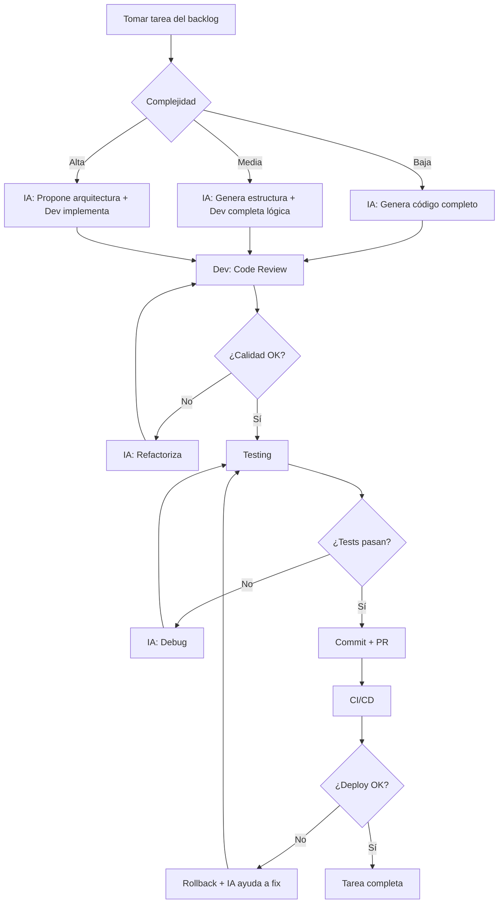

# 🤖 AI-DRIVEN DEVELOPMENT FRAMEWORK
## Metodología Universal para Equipos de Desarrollo

> **Propósito:** Framework agnóstico de tecnología para maximizar productividad con IA en cualquier proyecto  
> **Aplicable a:** Web, móvil, backend, frontend, fullstack  
> **Versión:** 1.0  

---

## 📚 TABLA DE CONTENIDOS

1. [Filosofía Core](#filosofía-core)
2. [Estructura de Documentos](#estructura-de-documentos)
3. [Workflow de 4 Fases](#workflow-de-4-fases)
4. [Roles y Responsabilidades](#roles-y-responsabilidades)
5. [Mejores Prácticas con IA](#mejores-prácticas-con-ia)
6. [Plantillas y Ejemplos](#plantillas-y-ejemplos)
7. [Métricas de Éxito](#métricas-de-éxito)

---

## 🎯 FILOSOFÍA CORE

### Principios Fundamentales

1. **IA como Multiplicador, No como Reemplazo**
   - La IA acelera, el humano decide
   - Criterio humano tiene veto final
   - IA propone, equipo dispone

2. **Documentación Viviente**
   - Docs se mantienen actualizados (no se pudren)
   - IA ayuda a mantener coherencia
   - Docs son fuente de verdad del proyecto

3. **Iteración Rápida con Validación Continua**
   - Sprints cortos (2-3 semanas)
   - Reviews frecuentes (2x/semana mínimo)
   - Fail fast, learn faster

4. **Transparencia Total**
   - Todo se documenta
   - Decisiones técnicas son rastreables
   - Dependencias son explícitas

---

## 📁 ESTRUCTURA DE DOCUMENTOS

### Setup Inicial de Proyecto

En **cualquier proyecto**, crear esta estructura:

```
<proyecto>/
├── .agent/
│   └── workflows/
│       └── context.md              ← Contexto del proyecto para IA
│
├── doc/
│   ├── WORKFLOW.md                 ← Este framework aplicado al proyecto
│   ├── Roadmap/
│   │   ├── ROADMAP_MAESTRO.md      ← Índice maestro con dependencias
│   │   └── roadmap_<feature>.md   ← Un roadmap por feature mayor
│   │
│   ├── Desarrollos/
│   │   ├── nuevos_requerimientos.md    ← Inbox de nuevos features
│   │   └── banco_de_preguntas.md       ← Knowledge base técnico
│   │
│   └── Arquitectura/
│       ├── decisiones.md           ← Architecture Decision Records (ADRs)
│       └── tecnologias.md          ← Stack tech y justificaciones
│
└── README.md                       ← Overview del proyecto
```

---

## 🔄 WORKFLOW DE 4 FASES

### ⚙️ FASE 1: DISCOVERY (Continuo)

**Objetivo:** Capturar y analizar requerimientos antes de planificar

#### 1.1 Captura de Requerimientos

**Quién:** PM / Product Owner

**Acción:**
```markdown
<!-- doc/Desarrollos/nuevos_requerimientos.md -->

# NUEVO FEATURE: [Nombre descriptivo]

## Descripción
[Qué se necesita y por qué]

## Usuarios afectados
- [Tipo de usuario 1]
- [Tipo de usuario 2]

## Criterios de aceptación
- [ ] Criterio 1
- [ ] Criterio 2

## Prioridad
Alta / Media / Baja

## Deadline (si aplica)
YYYY-MM-DD
```

#### 1.2 Análisis Técnico con IA

**Quién:** Tech Lead / Fullstack Senior

**Proceso:**
1. Conversar con IA sobre el requerimiento
2. Pedir análisis de:
   - Viabilidad técnica
   - Complejidad (1-10)
   - Dependencias
   - Tecnologías necesarias
   - Riesgos
   - Estimación inicial

3. IA documenta respuesta en `banco_de_preguntas.md`

**Output:** Requerimiento técnicamente validado

---

### 📋 FASE 2: PLANNING (Inicio de Sprint)

**Objetivo:** Convertir requerimientos en plan ejecutable

#### 2.1 Pre-Planning con IA (Async, 1-2 días antes)

**Quién:** Tech Lead + IA

**Proceso:**
```
1. Tech Lead solicita a IA:
   "Analiza [requerimiento] y genera un implementation plan"

2. IA analiza:
   - Archivos afectados
   - Cambios necesarios
   - Dependencias técnicas
   - Orden de implementación

3. IA genera:
   - implementation_plan.md
   - Estimaciones de esfuerzo
   - Roadmap individual (si es feature grande)
   - Actualización de ROADMAP_MAESTRO.md
```

**Plantilla de prompt para IA:**
```
Analiza este requerimiento: [pegar de nuevos_requerimientos.md]

Necesito:
1. Análisis de complejidad (1-10)
2. Archivos que debo crear/modificar
3. Dependencias con otros features
4. Propuesta de arquitectura
5. Estimación de tiempo
6. Riesgos potenciales
7. Plan de testing

Genera un implementation_plan.md completo.
```

#### 2.2 Sprint Planning Meeting (2h máx)

**Quién:** Todo el equipo

**Agenda:**
```
00:00 - 00:15 | PM presenta features priorizados
00:15 - 00:45 | Tech Lead presenta plan técnico generado por IA
              | Equipo debate, ajusta, valida
00:45 - 01:15 | Estimación de story points
              | Asignación de tareas
01:15 - 01:45 | Definir Sprint Goal
              | Métricas de éxito
01:45 - 02:00 | Q&A y cierre
```

**Output:**
- Sprint backlog en Jira/Trello/Linear
- Roadmap actualizado
- Métricas definidas

---

### ⚡ FASE 3: EXECUTION (Durante Sprint)

**Objetivo:** Implementar con velocidad y calidad

#### 3.1 Workflow Diario por Developer

**Estructura de trabajo:**



#### 3.2 Distribución por Complejidad

**Tareas Baja Complejidad (70% del trabajo):**
- CRUD simples
- UI components
- Validaciones
- Integraciones API standard

**Rol de IA:** Generar código completo  
**Rol de Dev:** Revisar + ajustar + testing

---

**Tareas Media Complejidad (20% del trabajo):**
- Features con lógica de negocio
- Integraciones complejas
- Optimizaciones

**Rol de IA:** Estructura + helpers  
**Rol de Dev:** Lógica core + testing

---

**Tareas Alta Complejidad (10% del trabajo):**
- Arquitectura nueva
- Migraciones de BD masivas
- Performance crítico

**Rol de IA:** Proponer soluciones  
**Rol de Dev:** Decisión + implementación

#### 3.3 Mejores Prácticas Diarias

**✅ DO:**
- Commit frecuente (varias veces al día)
- Pedir review de IA antes de PR humano
- Documentar decisiones no obvias
- Testing antes de commit
- Actualizar docs si cambia algo

**❌ DON'T:**
- Aceptar código de IA sin leer
- Commitear sin testing
- Dejar TODOs sin ticket
- Ignorar warnings de CI/CD
- Ocultar bloqueos al equipo

---

### 🔍 FASE 4: REVIEW & RETROSPECTIVE

**Objetivo:** Validar calidad y aprender

#### 4.1 Sprint Reviews (2x/semana)

**Cuando:** Martes y Jueves, 30 min

**Formato:**
```
00:00 - 00:10 | Cada dev muestra lo completado
00:10 - 00:20 | Demo en vivo
00:20 - 00:30 | PM valida vs criterios de aceptación
```

**Beneficio:** Detectar problemas ANTES del final del sprint

#### 4.2 Retrospectiva (Fin de Sprint)

**Cuando:** Último día del sprint, 1h

**Agenda con métricas IA:**

```
00:00 - 00:15 | Qué salió bien
              | Ejemplo: "IA generó feature X en 2 días vs 1 semana"

00:15 - 00:30 | Qué salió mal
              | Ejemplo: "IA alucinó validaciones, perdimos 4 horas"

00:30 - 00:45 | Métricas vs Sprint anterior
              | - Velocity (story points)
              | - Precisión de IA (% código usado sin cambios)
              | - Bugs post-deploy
              | - Time to market

00:45 - 01:00 | Acciones concretas para próximo sprint
              | - Mejorar prompts
              | - Documentar patterns que funcionan
              | - Actualizar workflows
```

---

## 👥 ROLES Y RESPONSABILIDADES

### Product Manager / Owner

**Sin IA (Antes):**
- Documentar requerimientos
- Esperar planning para saber viabilidad
- Priorizar a ciegas técnicamente

**Con IA (Ahora):**
- ✅ Documentar en `nuevos_requerimientos.md`
- ✅ Consultar viabilidad técnica a IA ANTES de priorizar
- ✅ Validar que implementation plans cumplen business goals
- ✅ Participar en demos mid-sprint

**KPI:** Time from idea to production

---

### Tech Lead / Architect

**Sin IA (Antes):**
- Diseñar arquitectura desde cero
- Revisar cada línea de código
- Apagar fuegos constantemente

**Con IA (Ahora):**
- ✅ Validar arquitecturas propuestas por IA
- ✅ Hacer pre-planning con IA (async)
- ✅ Mentoría sobre uso efectivo de IA
- ✅ Revisar código crítico (no todo)
- ✅ Ownership de decisiones técnicas finales

**KPI:** Team velocity, architectural debt

---

### Developers (Junior/Mid)

**Sin IA (Antes):**
- Escribir todo desde cero
- Perder tiempo en boilerplate
- Consultar Stack Overflow constantemente

**Con IA (Ahora):**
- ✅ Solicitar código base a IA
- ✅ Enfocarse en lógica de negocio
- ✅ Iterar rápido con IA
- ✅ SIEMPRE revisar código generado
- ✅ Testing exhaustivo

**KPI:** Lines of code produced, bug rate

---

### Scrum Master / Project Manager

**Sin IA (Antes):**
- Facilitar ceremonias
- Remover bloqueos
- Tracking manual en Jira

**Con IA (Ahora):**
- ✅ Todo lo anterior +
- ✅ Actualizar roadmaps semanalmente
- ✅ Trackear métricas de IA
- ✅ Facilitar adopción de IA en equipo
- ✅ Asegurar documentación actualizada

**KPI:** Team health, sprint predictability

---

## 🎓 MEJORES PRÁCTICAS CON IA

### 1. Cómo Escribir Buenos Prompts

#### ❌ Prompt Malo:
```
"Crea un login"
```

#### ✅ Prompt Bueno:
```
Necesito un sistema de login con estas características:

CONTEXTO:
- Proyecto: [Laravel 11, Livewire 3, Tailwind]
- Usuarios: admins, técnicos, clientes
- BD: MySQL con tabla users existente

REQUERIMIENTOS:
1. Login con email + password
2. Recordar sesión (checkbox)
3. Validación en tiempo real
4. Rate limiting (5 intentos/15min)
5. Redirección según rol

FORMATO:
- Livewire component
- Tailwind CSS moderno
- Validaciones Laravel
- Testing incluido

OUTPUT ESPERADO:
- Código del component
- Vista blade
- Tests
- Migración si es necesaria
```

**Diferencia:** Contexto + Especificidad = Mejor resultado

---

### 2. Patrón de Iteración con IA

```
PASO 1: Genera código inicial
  ↓
PASO 2: Revisa código (humano)
  ↓
PASO 3: Identifica problemas
  ↓
PASO 4: Pide correcciones específicas a IA
  ↓
PASO 5: Valida correcciones
  ↓
PASO 6: Testing
  ↓
PASO 7: Commit
```

**No hacer:** Aceptar primera versión sin revisar

---

### 3. Cuándo Usar IA vs Hacerlo Manual

#### ✅ Usar IA para:
- CRUD operations
- Boilerplate code
- Conversiones de formato
- Migrations simples
- Tests unitarios
- Documentación de código
- Refactoring sencillo
- Debugging de errores comunes

#### 🤔 Usar IA + Supervisión para:
- Lógica de negocio compleja
- Integraciones con APIs
- Optimizaciones de performance
- Queries complejas de BD
- Arquitectura de features

#### ❌ NO usar IA para:
- Decisiones de arquitectura final
- Seguridad crítica (validar SIEMPRE)
- Deployment a producción
- Manejo de datos sensibles
- Code review final (humano debe hacerlo)

---

### 4. Validación de Código Generado

**Checklist obligatorio:**

```markdown
Antes de aceptar código de IA, verificar:

- [ ] ¿El código compila/ejecuta sin errores?
- [ ] ¿Sigue las convenciones del proyecto?
- [ ] ¿Hay validaciones de seguridad apropiadas?
- [ ] ¿Maneja errores correctamente?
- [ ] ¿Tiene tests (o los agregaste)?
- [ ] ¿La lógica de negocio es correcta?
- [ ] ¿Es mantenible (no sobre-complejo)?
- [ ] ¿Está documentado lo no obvio?
- [ ] ¿No introduce deuda técnica?
- [ ] ¿Pasó linter/formatter?
```

**Regla de oro:** Si no entiendes el código, NO lo uses.

---

## 📝 PLANTILLAS Y EJEMPLOS

### Plantilla: nuevos_requerimientos.md

```markdown
# NUEVOS REQUERIMIENTOS

## CARTA A LA IA
Este archivo contiene los nuevos requerimientos del sistema. 
Cada vez que se completa algo, se borra de aquí y se genera 
documentación final en la carpeta correspondiente.

---

## REQUERIMIENTO #1: [Título descriptivo]

**Fecha:** YYYY-MM-DD  
**Solicitado por:** [Nombre]  
**Prioridad:** Alta/Media/Baja  

### Descripción
[Explicación clara del qué y por qué]

### Usuarios afectados
- [Rol 1]
- [Rol 2]

### Criterios de aceptación
- [ ] Criterio 1
- [ ] Criterio 2
- [ ] Criterio 3

### Notas adicionales
[Cualquier contexto relevante]

---

## REQUERIMIENTO #2: ...
```

---

### Plantilla: banco_de_preguntas.md

```markdown
# BANCO DE PREGUNTAS TÉCNICAS

## GUÍA
Formato estructurado para consultas técnicas a IA con respuestas documentadas.

---

## PREGUNTA #1: [Título]

**Categoría:** [Backend / Frontend / DevOps / Arquitectura]  
**Prioridad:** Alta/Media/Baja  
**Estado:** Pendiente/Respondida/Implementada  
**Fecha:** YYYY-MM-DD  
**Respondido por:** IA / [Nombre humano]

### Pregunta
[Pregunta técnica clara]

### Contexto
[Información relevante del proyecto]

### Respuesta

[Respuesta detallada de IA o del equipo]

### Decisión Final
[Qué se decidió implementar y por qué]

---
```

---

### Plantilla: ROADMAP_MAESTRO.md

```markdown
# ROADMAP MAESTRO - [PROYECTO]

## Niveles de Dependencia

### NIVEL 0: Fundación
Features que DEBEN estar primero

| Feature | Roadmap | Prioridad | Estado | Duración |
|---------|---------|-----------|--------|----------|
| [Feature] | [link] | 🔴 ALTA | Pendiente | X semanas |

### NIVEL 1: Optimización
Requiere: NIVEL 0 al 80%

### NIVEL 2: Experiencia Usuario
Requiere: NIVEL 1 completado

### NIVEL 3: Innovación
Requiere: NIVEL 2 completado

---

## Vista de Sprints

### Sprint 1: [Tema]
- Feature A
- Feature B
**Prerequisitos:** Ninguno
**Duración:** 2-3 semanas

### Sprint 2: [Tema]
...

---

## Reglas de Dependencias

1. No saltarse niveles
2. Prerequisitos son obligatorios
3. Evaluar antes de NIVEL 3+
```

---

## 📊 MÉTRICAS DE ÉXITO

### Métricas a Trackear Mensualmente

#### 1. Velocity

```
Story Points Completados / Sprint

Comparar:
- Promedio sin IA (histórico)
- Promedio con IA (actual)
- Tendencia (debe ser ↑)
```

#### 2. Precisión de IA

```
% de código generado por IA usado sin cambios mayores

Cálculo:
(Líneas de código IA aceptadas / Total líneas de código IA) × 100

Meta: > 70%
```

#### 3. Time to Market

```
Días desde requerimiento a producción

Comparar:
- Antes de IA: X días
- Después de IA: Y días
- Mejora: ((X-Y)/X) × 100%
```

#### 4. Calidad (No debe degradarse)

```
- Bugs post-deploy por sprint
- Code coverage (tests)
- Performance metrics

Meta: ≤ baseline histórico
```

#### 5. Adopción de IA

```
% de tareas donde se usó IA efectivamente

Cálculo:
(Tareas con IA / Total tareas) × 100

Meta: > 80%
```

#### 6. Satisfacción del Equipo

```
Encuesta mensual (escala 1-5):

1. ¿IA te hace más productivo?
2. ¿IA reduce frustración?
3. ¿Recomendarías trabajar con IA?
4. ¿Qué mejorar del workflow?

Meta: > 4.0 promedio
```

---

## 🚀 IMPLEMENTACIÓN DEL FRAMEWORK

### Paso 1: Setup Inicial (1 día)

**Checklist:**
```
- [ ] Crear estructura de carpetas /doc
- [ ] Crear plantillas de documentos
- [ ] Configurar acceso a IA para el equipo
- [ ] Crear .agent/workflows/context.md con info del proyecto
```

### Paso 2: Capacitación (1 semana)

**Día 1-2:** Teoría
- Presentar framework al equipo
- Explicar filosofía y beneficios
- Mostrar ejemplos de otros proyectos

**Día 3-4:** Práctica
- Ejercicios con IA (cada rol)
- Escribir buenos prompts
- Revisar código generado

**Día 5:** Simulacro
- Sprint planning simulado
- Development con IA
- Review y retrospectiva

### Paso 3: Piloto (1 sprint)

**Objetivo:** Validar framework en proyecto real

**Acciones:**
- Aplicar workflow completo
- Trackear métricas baseline
- Daily sync de adopción
- Retrospectiva especial sobre framework

### Paso 4: Ajuste (1 sprint)

**Objetivo:** Iterar sobre feedback

**Acciones:**
- Analizar métricas del piloto
- Identificar fricciones
- Ajustar workflows
- Documentar learnings

### Paso 5: Business as Usual (Continuo)

**Objetivo:** Framework integrado

**Acciones:**
- Workflow normal
- Métricas regulares
- Mejora continua
- Evangelizar en la organización

---

##⚠️ ANTI-PATTERNS (Qué NO hacer)

### 1. Dependencia Ciega de IA
❌ Aceptar todo sin revisar
✅ IA propone, humano valida

### 2. Abandonar Testing
❌ "IA escribió los tests, debe funcionar"
✅ Ejecutar tests, validar cobertura

### 3. No Documentar Decisiones
❌ Feature implementado sin contexto
✅ Documentar por qué se hizo X y no Y

### 4. Ignorar Code Review Humano
❌ IA revisó, deploy directo
✅ Otro humano revisa código crítico

### 5. Sobre-Complicar con IA
❌ Usar IA para TODO incluso lo simple
✅ Usar IA donde agrega valor real

### 6. No Trackear Métricas
❌ "Sentimos que vamos más rápido"
✅ Datos concretos de velocity y calidad

---

## 📚 RECURSOS ADICIONALES

### Templates de Prompts por Área

**Frontend Component:**
```
Genera un [tipo de component] con:
- Framework: [React/Vue/Livewire]
- Styling: [Tailwind/CSS/Styled-components]
- Props: [lista de props]
- Estado: [state necesario]
- Comportamiento: [eventos y lógica]
- Responsive: [breakpoints]
- Accesibilidad: [a11y requirements]
```

**Backend Endpoint:**
```
Genera un endpoint [método HTTP] /[ruta] que:
- Framework: [Laravel/Express/Django]
- Input: [request body/params]
- Validación: [reglas]
- Lógica: [qué hace]
- Output: [response format]
- Autenticación: [tipo]
- Rate limiting: [si/no]
- Tests incluidos
```

**Database Migration:**
```
Genera una migración para:
- BD: [MySQL/Postgres/Mongo]
- Tabla: [nombre]
- Campos: [lista con tipos]
- Índices: [cuáles]
- Foreign keys: [relaciones]
- Rollback: [cómo deshacer]
```

---

## 🎯 CHECKLIST DE ADOPCIÓN

### ¿Tu equipo está listo para este framework?

```
Prerequisitos:
- [ ] Equipo usa Git (control de versiones)
- [ ] Tienen metodología ágil (aunque sea básica)
- [ ] Acceso a IA conversacional (ChatGPT, Claude, etc)
- [ ] Cultura de documentación (aunque sea mínima)
- [ ] Disposición a cambiar workflows

Nice to have:
- [ ] CI/CD implementado
- [ ] Tests automatizados
- [ ] Code review obligatorio
- [ ] Retrospectivas regulares
```

Si tienes al menos 3/5 prerequisitos, **ADELANTE**.

---

## 💬 FAQs

### Q: ¿Funciona para equipos pequeños (2-3 personas)?
**R:** Sí, simplifica ceremonias pero mantén documentación.

### Q: ¿Funciona sin Scrum Master?
**R:** Sí, alguien debe asumir rol de mantener docs actualizados.

### Q: ¿Qué IA usar?
**R:** ChatGPT Plus, Claude, o similar. Necesitas contexto largo.

### Q: ¿Cuánto tiempo toma ver resultados?
**R:** Mejoras visibles en 1-2 sprints, consolidación en 1-2 meses.

### Q: ¿Funciona para proyectos legacy?
**R:** SÍ, especialmente útil para refactoring y documentación.

---

## 🌟 CONCLUSIÓN

Este framework no es dogma, es punto de partida.

**Adapta según tu contexto:**
- Equipo pequeño → simplifica ceremonias
- Equipo grande → más estructura
- Startup → prioriza velocidad
- Enterprise → prioriza documentación

**La clave:** Consistencia y mejora continua.

---

## 📝 Changelog

| Fecha | Versión | Cambios |
|-------|---------|---------|
| 2025-12-31 | 1.0 | Framework inicial |

---

> **"La mejor forma de predecir el futuro es construirlo, y con IA, construimos 3x más rápido."**
