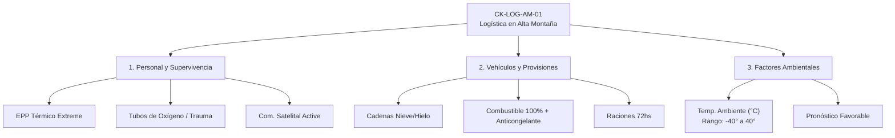

# 🏔️ Caso de Uso: Habilitación de Tránsito y Logística en Alta Montaña

Este documento describe el escenario operacional, la configuración técnica, el flujo de trabajo y la estructura de auditoría para el caso de uso de **Alta Montaña** en XamaSafe.

---

## 🏢 1. Entidades del Caso de Uso

### A. Empresa Cliente
* **Nombre Comercial:** Minera del Sol S.A.
* **Razón Social:** Minera del Sol S.A. Compañía de Oro y Plata
* **CUIT:** `30-77777777-7`
* **Rubro:** Minería Metalífera de Alta Montaña

### B. Sede Operativa (El sitio físico)
* **Nombre Sede:** Campamento Veladero (Alta Montaña)
* **Ubicación:** Cordillera de los Andes, Departamento Iglesia, Provincia de San Juan, Argentina.
* **Altitud:** ~4,100 msnm (metros sobre el nivel del mar).
* **Parámetros Técnicos y de Geolocalización (Proof of Presence):**
  - **Coordenadas GPS Base:** Latitud `-29.3562`, Longitud `-69.8978`
  - **Radio de Tolerancia GPS:** `1,000 metros` (parametrizado con tolerancia extendida debido a la dispersión geográfica del yacimiento y limitaciones de señal satelital en valles cordilleranos).
  - **Es Roster Minero 24/7:** `es_roster_24_7 = true`. Habilita el ingreso, check-in e inspecciones de campo los 365 días del año en cualquier horario, anulando las restricciones y alertas horarias del régimen laboral estándar de oficina.
  - **Rubro de la Sede:** Explotación Minera a Cielo Abierto.
* **Responsable de la Sede (Firma y Onboarding):**
  - **Nombre:** Ing. Juan Carlos Albarracín
  - **Cargo:** Superintendente de Seguridad y Salud Ocupacional (SSO)
  - **Email:** `jalbarracin@mineradelsol.com`

### C. Personal Técnico Asignado
* **Técnico Primario:** Técnico EP (`tecnico@app.com`).
* **Calificaciones:** Habilitado para conducción 4x4 en hielo/nieve, entrenamiento en altura extrema (SOP de mal de montaña / hipoxia) y comunicaciones satelitales.

---

## 📋 2. Estructura del Checklist: "Logística en Alta Montaña"
* **Código de Registro (registry_code):** `CK-LOG-AM-01`
* **Categoría / Subcategoría:** Inspecciones Especiales / Alta Montaña
* **Propósito:** Validar el estado del vehículo, equipamiento de supervivencia y condiciones ambientales antes de habilitar el ascenso/tránsito a cordillera.

### 📑 Detalle de Preguntas y Lógica de Falla

#### Sección 1: Personal y Equipo de Supervivencia
1. **¿Todo el personal cuenta con EPP de abrigo extremo (térmico) y de montaña?**
   - *Tipo:* `select` (Opciones: `["Sí", "No"]`)
   - *Restricción:* Obligatorio.
   - *Lógica de Falla:* `fail_if_selected` con valor de falla `["No"]`.
   - *Ayuda:* Exige campera térmica de pluma, calzas térmicas, guantes de nieve, pasamontañas y calzado rígido homologado.
2. **¿Se dispone de equipo de oxígeno portátil y botiquín de trauma completo?**
   - *Tipo:* `select` (Opciones: `["Sí", "No"]`)
   - *Restricción:* Obligatorio.
   - *Lógica de Falla:* `fail_if_selected` con valor de falla `["No"]`.
   - *Ayuda:* Verificar la carga del manómetro y fecha de vencimiento de las máscaras.
3. **¿Se cuenta con equipo de comunicación satelital (InReach/Iridium) activo?**
   - *Tipo:* `select` (Opciones: `["Sí", "No"]`)
   - *Restricción:* Obligatorio.
   - *Lógica de Falla:* `fail_if_selected` con valor de falla `["No"]`.
   - *Ayuda:* Realizar un ping de prueba al Centro de Control Minero antes de salir.

#### Sección 2: Vehículos y Tránsito Cordillerano
4. **¿El vehículo posee cadenas para hielo/nieve homologadas?**
   - *Tipo:* `select` (Opciones: `["Sí", "No"]`)
   - *Restricción:* Obligatorio.
   - *Lógica de Falla:* `fail_if_selected` con valor de falla `["No"]`.
   - *Ayuda:* Probar el correcto calce en las cubiertas antes del inicio del tramo de tierra.
5. **¿Nivel de combustible al 100% y aditivo anticongelante verificado?**
   - *Tipo:* `select` (Opciones: `["Sí", "No"]`)
   - *Restricción:* Obligatorio.
   - *Lógica de Falla:* `fail_if_selected` con valor de falla `["No"]`.
   - *Ayuda:* El aditivo debe ser apto para temperaturas de hasta -25°C.
6. **¿Se dispone de raciones de supervivencia y agua para 72 horas?**
   - *Tipo:* `select` (Opciones: `["Sí", "No"]`)
   - *Restricción:* Obligatorio.
   - *Lógica de Falla:* `fail_if_selected` con valor de falla `["No"]`.
   - *Ayuda:* Calcular raciones de comida liofilizada o hipercalórica según la cantidad de tripulantes.

#### Sección 3: Factores Ambientales
7. **Temperatura ambiente en grados Celsius (°C):**
   - *Tipo:* `number` (Rango: `-40` a `40`)
   - *Restricción:* Obligatorio.
   - *Lógica de Falla:* Falla automáticamente si el valor está fuera del rango establecido (ej. `-27°C` es válido, pero `-42°C` dispara la alerta).
8. **¿Pronóstico meteorológico favorable para el tránsito por el periodo solicitado?**
   - *Tipo:* `select` (Opciones: `["Sí", "No"]`)
   - *Restricción:* Obligatorio.
   - *Lógica de Falla:* `fail_if_selected` con valor de falla `["No"]`.
   - *Ayuda:* Descartar alertas oficiales de viento blanco o tormentas de nieve severas.

---

## 🔄 3. Flujo Operativo en XamaSafe

1. **Planificación:** El Gestor de la consultora asigna el checklist `CK-LOG-AM-01` en la planificación mensual de la sede `Campamento Veladero (Alta Montaña)` para el técnico `tecnico@app.com`.
2. **Arribo y Geolocalización (Check-in):** El técnico llega al puesto de control o al ingreso del yacimiento. Abre la APP y pulsa **Iniciar Visita**. El sistema geolocaliza al técnico y valida que esté dentro de los 1,000m de tolerancia terrestres de la sede mediante la **Fórmula de Haversine**, permitiendo la apertura de la visita presencial.
3. **Inspección de Tránsito:** El técnico ejecuta el checklist **"Logística en Alta Montaña"** en la pestaña de Misiones. Completa el wizard de preguntas.
   - Si responde "No" a la disponibilidad de cadenas, se levanta de inmediato una alerta de no-conformidad y la inspección finaliza con resultado **"Falló"** (`result = 'fail'`).
   - El asistente en la UI muestra arriba de la barra de carga el HUD badge naranja `"⌚ Tiempo Real (Sync Servidor)"` indicando el blindaje del timestamp.
4. **Cierre de Visita (Check-out):** Al completar los controles y verificar el camión, el Superintendente de la Sede (`Ing. Juan Carlos Albarracín`) firma electrónicamente en la tablet del técnico. El sistema calcula las horas efectivas en campo, la salida GPS y genera la constancia PDF firmada digitalmente enviando el aviso por correo.

---
*Documento de Caso de Uso para XamaSafe v2.2 | Alta Montaña SSO Ops*
