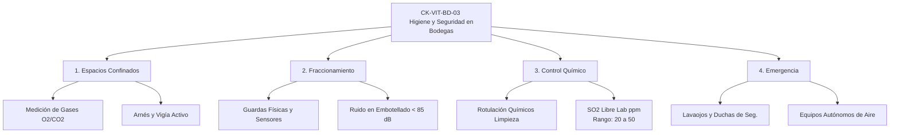

# 🍇 Caso de Uso: Control de Calidad, Higiene y Seguridad en Bodega Vitivinícola

Este documento describe el escenario operacional, la configuración técnica, el flujo de trabajo y la estructura de auditoría para el caso de uso de la **Industria Vitivinícola (Bodegas y Viñedos)** en San Juan, Argentina, dentro de XamaSafe.

---

## 🏢 1. Entidades del Caso de Uso

### A. Empresa Cliente
* **Nombre Comercial:** Bodegas Valle de Zonda S.A.
* **Razón Social:** Bodegas Valle de Zonda S.A.
* **CUIT:** `30-55667788-9`
* **Rubro:** Elaboración, Crianza, Fraccionamiento y Exportación de Vinos Finos

### B. Sede Operativa (La Bodega)
* **Nombre Sede:** Bodega y Planta de Fraccionamiento (Zonda)
* **Ubicación:** Ruta Provincial 12 km 24, Valle de Zonda, Provincia de San Juan, Argentina. (Zona rodeada de cerros y viñedos autóctonos).
* **Parámetros Técnicos y de Geolocalización (Proof of Presence):**
  - **Coordenadas GPS Base:** Latitud `-31.5543`, Longitud `-68.7231`
  - **Radio de Tolerancia GPS:** `300 metros` (tolerancia media calculada para cubrir toda la nave de fermentación, laboratorio, línea de embotellado, cavas subterráneas y sector de carga/despacho).
  - **Es Roster Minero 24/7:** `es_roster_24_7 = false`. Rige bajo jornada operativa estándar, excepto durante el período especial de **Vendimia** (Febrero a Abril) donde las tareas de molienda y recepción de uva se extienden a regímenes continuos nocturnos coordinados administrativamente.
  - **Días y Horarios Operativos de Jornada:**
    * *Días Operativos:* Lunes, Martes, Miércoles, Jueves y Viernes.
    * *Hora de Apertura:* `08:00 hs`
    * *Hora de Cierre:* `17:00 hs`
* **Responsable de la Sede (Firma y Onboarding):**
  - **Nombre:** Ing. Enól. Sofía Donati
  - **Cargo:** Directora de Enología y Operaciones de Planta
  - **Email:** `sdonati@valledezonda.com.ar`

### C. Personal Técnico Asignado
* **Técnico Primario:** Técnico EP (`tecnico@app.com`).
* **Especialidad:** Auditor de Higiene, Seguridad y Sistemas de Calidad Agroalimentaria (BPA, HACCP, ISO 22000).

---

## 📋 2. Estructura del Checklist: "Higiene y Seguridad en Bodegas"
* **Código de Registro (registry_code):** `CK-VIT-BD-03`
* **Categoría / Subcategoría:** Auditoría de Calidad e Higiene / Establecimientos Vitivinícolas
* **Propósito:** Controlar los riesgos de asfixia por gas carbónico en espacios confinados (piletas/tanques) y verificar la inocuidad y seguridad en la línea de fraccionamiento.

### 📑 Detalle de Preguntas y Lógica de Falla

#### Sección 1: Espacios Confinados (Tanques y Vasijas de Fermentación)
1. **¿Se realiza medición de gases (oxígeno y anhídrido carbónico) antes del ingreso de operarios a limpiar tanques o piletas de fermentación?**
   - *Tipo:* `select` (Opciones: `["Sí", "No"]`)
   - *Restricción:* Obligatorio.
   - *Lógica de Falla:* `fail_if_selected` con valor de falla `["No"]`.
   - *Ayuda:* **Peligro Extremo:** La fermentación de la uva produce grandes volúmenes de dióxido de carbono (anhídrido carbónico), un gas asfixiante invisible conocido en bodegas como "el gas de las piletas".
2. **¿El personal cuenta con arnés, cuerda de vida y un vigía externo activo permanentemente al ingresar a las vasijas?**
   - *Tipo:* `select` (Opciones: `["Sí", "No"]`)
   - *Restricción:* Obligatorio.
   - *Lógica de Falla:* `fail_if_selected` con valor de falla `["No"]`.

#### Sección 2: Fraccionamiento y Líneas de Embotellado
3. **¿Se encuentran operativas las guardas físicas de seguridad y los sensores de parada de emergencia en las cintas transportadoras y máquinas tapadoras/etiquetadoras?**
   - *Tipo:* `select` (Opciones: `["Sí", "No"]`)
   - *Restricción:* Obligatorio.
   - *Lógica de Falla:* `fail_if_selected` con valor de falla `["No"]`.
   - *Ayuda:* Evita atrapamientos y lesiones mecánicas con botellas de vidrio en movimiento rápido.
4. **¿El nivel de ruido en la sala de embotellado se encuentra por debajo de 85 dB o se utiliza la protección auditiva correspondiente?**
   - *Tipo:* `select` (Opciones: `["Sí", "No"]`)
   - *Restricción:* Obligatorio.
   - *Lógica de Falla:* `fail_if_selected` con valor de falla `["No"]`.

#### Sección 3: Control Químico y Sanitización
5. **¿Se encuentran correctamente rotulados e identificados los productos químicos de limpieza (soda cáustica, ácido nítrico, metabisulfito) en el pañol químico?**
   - *Tipo:* `select` (Opciones: `["Sí", "No"]`)
   - *Restricción:* Obligatorio.
   - *Lógica de Falla:* `fail_if_selected` con valor de falla `["No"]`.
6. **Concentración de Anhídrido Sulfuroso (SO2) libre registrado en laboratorio para el fraccionamiento (ppm):**
   - *Tipo:* `number` (Rango: `20` a `50`)
   - *Restricción:* Obligatorio.
   - *Lógica de Falla:* Falla automáticamente si el valor está fuera del rango establecido (20 ppm a 50 ppm).
   - *Ayuda:* El metabisulfito de potasio protege al vino de la oxidación y bacterias, pero concentraciones excesivas son tóxicas y fuera de norma de exportación INV.

#### Sección 4: Elementos de Emergencia
7. **¿Las estaciones lavaojos y duchas de seguridad próximas al sector de dosificación química y limpieza de piletas se encuentran despejadas y operativas?**
   - *Tipo:* `select` (Opciones: `["Sí", "No"]`)
   - *Restricción:* Obligatorio.
   - *Lógica de Falla:* `fail_if_selected` con valor de falla `["No"]`.
8. **¿Se dispone de equipos autónomos de respiración accesibles en la sala de tanques para casos de fugas accidentales de gases?**
   - *Tipo:* `select` (Opciones: `["Sí", "No"]`)
   - *Restricción:* Obligatorio.
   - *Lógica de Falla:* `fail_if_selected` con valor de falla `["No"]`.

---

## 🔄 3. Flujo Operativo en XamaSafe

1. **Check-in en Bodega:** El Técnico EP arriba a la finca en Zonda. El sistema GPS valida su ubicación geográfica a menos de 300m del punto central del establecimiento minero/agroindustrial e inicia el registro de la visita.
2. **Auditoría e Inspección de Piletas:** Durante la limpieza post-trasiego, el técnico audita las piletas. Utiliza el checklist `CK-VIT-BD-03`. Si constata que el detector de gas de piletas no está calibrado, marca "No" en la medición de gases. Se genera de inmediato una no-conformidad crítica.
3. **Cierre de Visita:** La Directora de Enología (`Ing. Sofía Donati`) firma en pantalla la conformidad y el informe consolidado se remite al correo de operaciones del establecimiento vitivinícola.

---
*Documento de Caso de Uso para XamaSafe v2.2 | Vitivinicultura San Juan*
