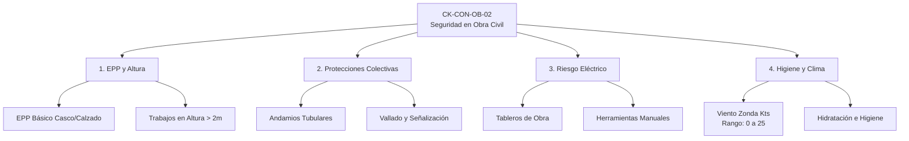

# 🏗️ Caso de Uso: Inspección de Seguridad en Obra Civil (Construcción)

Este documento describe el escenario operacional, la configuración técnica, el flujo de trabajo y la estructura de auditoría para el caso de uso de **Construcción** en San Juan, Argentina, dentro de XamaSafe.

---

## 🏢 1. Entidades del Caso de Uso

### A. Empresa Cliente
* **Nombre Comercial:** Constructora Horizonte S.A.
* **Razón Social:** Constructora Horizonte S.A.
* **CUIT:** `30-11223344-5`
* **Rubro:** Construcción Civil, Edificaciones y Obras de Arquitectura

### B. Sede Operativa (La Obra)
* **Nombre Sede:** Edificio Torres del Sol (Obra Civil)
* **Ubicación:** Av. Ignacio de la Roza 450 Oeste, Ciudad de San Juan, Provincia de San Juan, Argentina. (Zona urbana de alta densidad).
* **Parámetros Técnicos y de Geolocalización (Proof of Presence):**
  - **Coordenadas GPS Base:** Latitud `-31.5375`, Longitud `-68.5364`
  - **Radio de Tolerancia GPS:** `150 metros` (tolerancia compacta debido a que es una zona urbana consolidada con óptima precisión de posicionamiento y señal celular).
  - **Es Roster Minero 24/7:** `es_roster_24_7 = false`. Rige bajo calendario y horario laboral estándar de la construcción en Argentina.
  - **Días y Horarios Operativos de Jornada:**
    * *Días Operativos:* Lunes, Martes, Miércoles, Jueves, Viernes y Sábados.
    * *Hora de Apertura:* `07:00 hs`
    * *Hora de Cierre:* `17:00 hs` (Lunes a Viernes) / `12:00 hs` (Sábados).
  - **Control de Sobrejornada:** El sistema emitirá alertas visuales en el dashboard de la consultora si el técnico registra marcas horarias de check-out posteriores a las 17:30 hs.
* **Responsable de la Sede (Firma y Onboarding):**
  - **Nombre:** Ing. Carlos Taglio
  - **Cargo:** Jefe de Obra / Director del Proyecto
  - **Email:** `ctaglio@horizonte.com.ar`

### C. Personal Técnico Asignado
* **Técnico Primario:** Técnico EP (`tecnico@app.com`).
* **Matrícula Profesional:** Registro del Colegio de Profesionales de Higiene y Seguridad de la Provincia de San Juan.

---

## 📋 2. Estructura del Checklist: "Seguridad en Obra Civil"
* **Código de Registro (registry_code):** `CK-CON-OB-02`
* **Categoría / Subcategoría:** Inspecciones de Obra / Edificación Civil
* **Propósito:** Verificar el cumplimiento de la Ley 22.250 y Decreto 911/96 de Higiene y Seguridad en la Construcción.

### 📑 Detalle de Preguntas y Lógica de Falla

#### Sección 1: EPP y Protecciones Individuales
1. **¿Todo el personal en obra utiliza casco de seguridad, calzado con puntera de acero y chaleco reflectivo?**
   - Tipo: Selección (Opciones: Sí, No)
   - Restricción: Obligatorio.
   - Lógica de Falla: en respuesta No
   - Ayuda: Verificar el uso obligatorio de arnés y elementos auxiliares.
2. **¿Los operarios que realizan trabajos en altura (> 2 metros) utilizan arnés anticaídas de cuerpo completo acoplado a línea de vida independiente?**
   - Tipo: Selección (Opciones: Sí, No)
   - Restricción: Obligatorio.
   - Lógica de Falla: en respuesta No
   - Ayuda: Prohibido amarrarse a caños de andamios sueltos.

#### Sección 2: Protecciones Colectivas y Andamios
3. **¿Los andamios tubulares de trabajo cuentan con tablones metálicos trabados, barandas perimetrales dobles y rodapiés?**
   - Tipo: Selección (Opciones: Sí, No)
   - Restricción: Obligatorio.
   - Lógica de Falla: en respuesta No
   - Ayuda: Exigir nivelación de bases mediante husillos roscados y anclaje a estructura sólida.
4. **¿Se encuentran señalizadas y valladas las zonas de excavación, huecos de ascensor y sectores con riesgo de caída de objetos?**
   - Tipo: Selección (Opciones: Sí, No)
   - Restricción: Obligatorio.
   - Lógica de Falla: en respuesta No

#### Sección 3: Riesgo Eléctrico y Maquinaria
5. **¿Los tableros eléctricos provisorios de obra poseen disyuntor diferencial, llaves térmicas y puesta a tierra operativa?**
   - Tipo: Selección (Opciones: Sí, No)
   - Restricción: Obligatorio.
   - Lógica de Falla: en respuesta No
   - Ayuda: Comprobar que las tomas de corriente posean la tapa correspondiente y el gabinete esté cerrado bajo llave.
6. **¿Las herramientas eléctricas manuales (amoladoras, rotomartillos) poseen sus protecciones de resguardo y cables sin empalmes expuestos?**
   - Tipo: Selección (Opciones: Sí, No)
   - Restricción: Obligatorio.
   - Lógica de Falla: en respuesta No

#### Sección 4: Condiciones Ambientales e Higiene
7. **Velocidad del viento registrada en nudos (Kts) para trabajos en altura:**
   - Tipo: Numérico (Rango: 0 a 25)
   - Restricción: Obligatorio.
   - Lógica de Falla: si supera los 22 nudos (Kts)
   - Ayuda: **Alerta Viento Zonda:** Típico viento cálido y extremadamente seco de San Juan, con ráfagas severas que incrementan el riesgo de caídas en altura. Suspender tareas en andamios colgantes o techos si la velocidad es de alarma.
8. **¿Se dispone de agua potable fresca y sanitarios químicos limpios en cantidad adecuada?**
   - Tipo: Selección (Opciones: Sí, No)
   - Restricción: Obligatorio.
   - Lógica de Falla: en respuesta No
   - Ayuda: **Verano Sanjuanino:** Las temperaturas superan los 40°C. La hidratación constante es obligatoria para prevenir golpes de calor en obra.

---

## 🔄 3. Flujo Operativo en XamaSafe

1. **Check-in GPS:** El Técnico arriba a la obra del edificio en Av. Ignacio de la Roza. Realiza el check-in. El sistema de geolocalización de XamaSafe valida su presencia dentro de la tolerancia de 150m, iniciando el cronómetro de la visita.
2. **Ejecución y Desvíos:** El técnico recorre los pisos de la estructura completando el checklist. Detecta que un andamio en el 3° piso carece de rodapiés. Marca "No" en la pregunta 3, lo que gatilla una no-conformidad automática con alerta de riesgo. Toma fotografías de evidencia e inicia un **Hallazgo** asociado.
3. **Cierre de Visita:** El Jefe de Obra (`Ing. Carlos Taglio`) valida el resumen e inyecta su firma táctica para la Constancia de Visita Digital en formato PDF.

---
*Documento de Caso de Uso para XamaSafe v2.2 | Construcción Civil San Juan*
