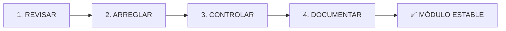

# 🔧 Roadmap de Estabilización - EP-Back
## Versión Estable Pre-Multi-Tenant

> **Objetivo**: Revisar, arreglar y controlar todos los módulos para entregar una versión estable y testeada antes de implementar multi-tenancy.

> **Filosofía**: **REVISAR → ARREGLAR → CONTROLAR → DOCUMENTAR**

---

## 📋 Metodología de Trabajo

### Proceso por Módulo



### Checklist por Módulo

Para cada módulo, completar:

- [ ] **REVISAR**: Auditoría funcional completa
  - [ ] Probar todas las rutas y funcionalidades
  - [ ] Identificar bugs, errores y problemas UX
  - [ ] Documentar hallazgos en Trello/Issues
  
- [ ] **ARREGLAR**: Corrección de problemas
  - [ ] Priorizar bugs críticos
  - [ ] Corregir errores de validación
  - [ ] Mejorar UX/UI inconsistente
  - [ ] Optimizar queries lentas
  
- [ ] **CONTROLAR**: Testing y validación
  - [ ] Testing manual de flujos completos
  - [ ] Validar datos en BD
  - [ ] Verificar permisos y roles
  - [ ] Testing de edge cases
  
- [ ] **DOCUMENTAR**: Registro de estado
  - [ ] Actualizar documentación técnica
  - [ ] Marcar como "ESTABLE" en Trello
  - [ ] Documentar casos de uso

---

## 🎯 Módulos del Sistema

### Categorización por Prioridad

| Prioridad | Módulo | Complejidad | Días Est. |
|-----------|--------|-------------|-----------|
| 🔴 **CRÍTICA** | Checklists Dinámicos | Alta | 3-4 |
| 🔴 **CRÍTICA** | Gestión de Usuarios y Roles | Media | 2-3 |
| 🟡 **ALTA** | Capacitaciones (Presencial/Virtual) | Media | 2-3 |
| 🟡 **ALTA** | Generación de PDFs | Media | 2 |
| 🟡 **ALTA** | Empresas y Sedes | Baja | 1-2 |
| 🟢 **MEDIA** | Hallazgos | Media | 2 |
| 🟢 **MEDIA** | Riesgos | Media | 2 |
| 🟢 **MEDIA** | Sistema de Correos | Baja | 1 |
| 🟢 **MEDIA** | Informes | Media | 2 |
| ⚪ **BAJA** | Constancias | Baja | 1 |
| ⚪ **BAJA** | Items y Categorías | Baja | 1 |

**Total estimado**: 19-24 días de trabajo

---

## 📦 MÓDULO 1: Checklists Dinámicos 🔴

**Prioridad**: CRÍTICA (Core del sistema)

### Estado Actual
- Funcionalidad principal del sistema
- Múltiples controladores y vistas
- Complejidad alta por relaciones

### Checklist de Revisión

#### 1.1 REVISAR
- [ ] **Creación de Checklists**
  - [ ] Crear categorías y subcategorías
  - [ ] Asignar secciones y preguntas
  - [ ] Validar estructura jerárquica
  
- [ ] **Asignación de Checklists**
  - [ ] Asignar a operarios
  - [ ] Verificar permisos de asignación
  - [ ] Validar fechas y plazos
  
- [ ] **Completado de Checklists**
  - [ ] Operario puede ver checklists asignados
  - [ ] Marcar ítems como completados
  - [ ] Adjuntar evidencias (fotos, comentarios)
  
- [ ] **Reportes y Seguimiento**
  - [ ] Dashboard de progreso
  - [ ] Historial de completados
  - [ ] Exportación de datos

#### 1.2 ARREGLAR
- [ ] Bugs identificados en revisión
- [ ] Validaciones faltantes
- [ ] Problemas de permisos
- [ ] UX confusa o inconsistente

#### 1.3 CONTROLAR
- [ ] Testing de flujo completo:
  1. Admin crea checklist
  2. Admin asigna a operario
  3. Operario completa checklist
  4. Admin revisa completado
- [ ] Validar datos en BD (integridad referencial)
- [ ] Testing con múltiples roles

#### 1.4 DOCUMENTAR
- [ ] Actualizar `doc/MODULOS/checklists.md`
- [ ] Casos de uso documentados
- [ ] Screenshots de flujos principales

**Estimación**: 3-4 días

---

## 👥 MÓDULO 2: Gestión de Usuarios y Roles 🔴

**Prioridad**: CRÍTICA (Seguridad y acceso)

### Estado Actual
- Sistema de roles implementado
- Permisos por módulo
- Relación con empresas/sedes

### Checklist de Revisión

#### 2.1 REVISAR
- [ ] **Roles Existentes**
  - [ ] Listar todos los roles activos
  - [ ] Verificar permisos de cada rol
  - [ ] Validar jerarquía de roles
  
- [ ] **Gestión de Usuarios**
  - [ ] Crear usuarios
  - [ ] Asignar roles
  - [ ] Asignar a empresas/sedes
  - [ ] Activar/desactivar usuarios
  
- [ ] **Control de Acceso**
  - [ ] Middleware de autenticación
  - [ ] Middleware de autorización
  - [ ] Redirecciones según rol
  - [ ] Protección de rutas

#### 2.2 ARREGLAR
- [ ] Permisos inconsistentes
- [ ] Rutas sin protección
- [ ] Problemas de redirección post-login
- [ ] Validaciones de formularios
- [ ] **MEJORA**: Implementar lógica de "Reasignación Inteligente" al eliminar usuario (detectar tareas pendientes y reasignar).

#### 2.3 CONTROLAR
- [ ] Testing por cada rol:
  - [ ] Super Admin
  - [ ] Admin
  - [ ] Gestor
  - [ ] Operario
  - [ ] Otros roles
- [ ] Intentar acceso no autorizado (security testing)
- [ ] Validar sesiones y logout

#### 2.4 DOCUMENTAR
- [ ] Matriz de permisos por rol
- [ ] Flujo de autenticación
- [ ] Documentar en `doc/MODULOS/usuarios_roles.md`

**Estimación**: 2-3 días

---

## 📚 MÓDULO 3: Capacitaciones (Presencial/Virtual) 🟡

**Prioridad**: ALTA

### Estado Actual
- Dos controladores: `CapacitacionPresencialController`, `CapacitacionVirualController`
- Gestión de capacitaciones y asistentes

### Checklist de Revisión

#### 3.1 REVISAR
- [ ] **Capacitaciones Presenciales**
  - [ ] Crear capacitación
  - [ ] Asignar participantes
  - [ ] Registrar asistencia
  - [ ] Generar constancias
  
- [ ] **Capacitaciones Virtuales**
  - [ ] Crear capacitación virtual
  - [ ] Gestión de participantes
  - [ ] Seguimiento de completado
  
- [ ] **Reportes**
  - [ ] Historial de capacitaciones
  - [ ] Estadísticas de asistencia
  - [ ] Exportación de datos

#### 3.2 ARREGLAR
- [ ] Bugs en formularios
- [ ] Validaciones de fechas
- [ ] Problemas de duplicados
- [ ] UX inconsistente entre presencial/virtual

#### 3.3 CONTROLAR
- [ ] Testing de flujo completo presencial
- [ ] Testing de flujo completo virtual
- [ ] Validar generación de constancias
- [ ] Testing con múltiples participantes

#### 3.4 DOCUMENTAR
- [ ] Diferencias entre presencial y virtual
- [ ] Flujos documentados
- [ ] `doc/MODULOS/capacitaciones.md`

**Estimación**: 2-3 días

---

## 📄 MÓDULO 4: Generación de PDFs 🟡

**Prioridad**: ALTA (Funcionalidad transversal)

### Estado Actual
- Múltiples controladores de PDF:
  - `PDFController`
  - `EppPDFController`
  - `InspectionPDFController`
  - `TrainingPDFController`
  - `VisitCertificatePDFController`

### Checklist de Revisión

#### 4.1 REVISAR
- [ ] **PDFs de Checklists**
  - [ ] Generar PDF de checklist completado
  - [ ] Validar formato y diseño
  - [ ] Incluir evidencias (imágenes)
  
- [ ] **PDFs de Capacitaciones**
  - [ ] Constancias de capacitación
  - [ ] Certificados de asistencia
  
- [ ] **PDFs de Inspecciones**
  - [ ] Reportes de inspección
  - [ ] Hallazgos y observaciones
  
- [ ] **PDFs de Visitas**
  - [ ] Certificados de visita
  
- [ ] **PDFs de EPP**
  - [ ] Reportes de EPP

#### 4.2 ARREGLAR
- [ ] Problemas de formato
- [ ] Imágenes que no cargan
- [ ] Estilos CSS inconsistentes
- [ ] Errores de generación
- [ ] Performance (PDFs lentos)

#### 4.3 CONTROLAR
- [ ] Generar cada tipo de PDF
- [ ] Validar contenido correcto
- [ ] Testing en diferentes navegadores
- [ ] Validar descarga vs. preview

#### 4.4 DOCUMENTAR
- [ ] Tipos de PDFs disponibles
- [ ] Plantillas utilizadas
- [ ] `doc/MODULOS/pdfs.md`

**Estimación**: 2 días

---

## 🏢 MÓDULO 5: Empresas y Sedes 🟡

**Prioridad**: ALTA (Datos maestros)

### Estado Actual
- `EmpresaController`
- `SedeController`
- `SedeUserController`
- Relación con usuarios

### Checklist de Revisión

#### 5.1 REVISAR
- [ ] **Gestión de Empresas**
  - [ ] Crear empresa
  - [ ] Editar empresa
  - [ ] Listar empresas
  - [ ] Desactivar empresa
  
- [ ] **Gestión de Sedes**
  - [ ] Crear sede (asociada a empresa)
  - [ ] Editar sede
  - [ ] Listar sedes por empresa
  - [ ] Desactivar sede
  
- [ ] **Asignación de Usuarios**
  - [ ] Asignar usuarios a sedes
  - [ ] Validar permisos por sede

#### 5.2 ARREGLAR
- [ ] Validaciones de formularios
- [ ] Problemas de duplicados
- [ ] Relaciones inconsistentes
- [ ] UX de asignación de usuarios

#### 5.3 CONTROLAR
- [x] Testing de CRUD completo
- [x] Validar relaciones en BD
- [x] Testing de asignación de usuarios
- [x] Validar filtros por empresa/sede

#### 5.4 DOCUMENTAR
- [x] Modelo de datos
- [x] Relaciones entre entidades
- [x] `doc/MODULOS/empresas_sedes.md`
- [x] **Nota**: Se recomienda agregar campos adicionales (dirección, teléfono, email) en futuras versiones para Empresas.

**Estimación**: 1-2 días (COMPLETADO)

---

## 🔍 MÓDULO 6: Hallazgos 🟢

**Prioridad**: MEDIA

### Estado Actual
- Carpeta `Hallazgos` en controllers
- Gestión de hallazgos en inspecciones

### Checklist de Revisión

#### 6.1 REVISAR
- [ ] Crear hallazgo
- [ ] Editar hallazgo
- [ ] Asignar responsable
- [ ] Seguimiento de hallazgos
- [ ] Cerrar hallazgo
- [ ] Reportes de hallazgos

#### 6.2 ARREGLAR
- [ ] Bugs identificados
- [ ] Validaciones faltantes
- [ ] Flujo de seguimiento

#### 6.3 CONTROLAR
- [ ] Testing de flujo completo
- [ ] Validar estados de hallazgos
- [ ] Testing de notificaciones (si aplica)

#### 6.4 DOCUMENTAR
- [ ] Estados de hallazgos
- [ ] Flujo de trabajo
- [ ] `doc/MODULOS/hallazgos.md`

**Estimación**: 2 días

---

## ⚠️ MÓDULO 7: Riesgos 🟢

**Prioridad**: MEDIA

### Estado Actual
- Carpeta `Risks` en controllers
- Gestión de riesgos

### Checklist de Revisión

#### 7.1 REVISAR
- [ ] Crear riesgo
- [ ] Editar riesgo
- [ ] Clasificar riesgo (severidad, probabilidad)
- [ ] Asignar controles
- [ ] Seguimiento de riesgos
- [ ] Reportes

#### 7.2 ARREGLAR
- [ ] Bugs identificados
- [ ] Validaciones
- [ ] Cálculos de matriz de riesgos

#### 7.3 CONTROLAR
- [ ] Testing de CRUD
- [ ] Validar cálculos
- [ ] Testing de reportes

#### 7.4 DOCUMENTAR
- [ ] Metodología de riesgos
- [ ] Matriz de riesgos
- [ ] `doc/MODULOS/riesgos.md`

**Estimación**: 2 días

---

## 📧 MÓDULO 8: Sistema de Correos 🟢

**Prioridad**: MEDIA

### Estado Actual
- `CorreoController`
- `CorreoContactoController`
- Envío de notificaciones

### Checklist de Revisión

#### 8.1 REVISAR
- [ ] Configuración de correo (SMTP)
- [ ] Envío de notificaciones automáticas
- [ ] Formulario de contacto
- [ ] Templates de correo
- [ ] Logs de correos enviados

#### 8.2 ARREGLAR
- [ ] Correos que no llegan
- [ ] Templates con errores
- [ ] Configuración de remitente
- [ ] Validaciones de formularios

#### 8.3 CONTROLAR
- [ ] Testing de envío de correos
- [ ] Validar templates
- [ ] Testing de formulario de contacto
- [ ] Verificar logs

#### 8.4 DOCUMENTAR
- [ ] Configuración de correo
- [ ] Tipos de notificaciones
- [ ] `doc/MODULOS/correos.md`

**Estimación**: 1 día

---

## 📊 MÓDULO 9: Informes 🟢

**Prioridad**: MEDIA

### Estado Actual
- `InformeController`
- Generación de reportes

### Checklist de Revisión

#### 9.1 REVISAR
- [ ] Tipos de informes disponibles
- [ ] Filtros de informes
- [ ] Exportación (Excel, PDF)
- [ ] Visualización de datos

#### 9.2 ARREGLAR
- [ ] Bugs en filtros
- [ ] Problemas de exportación
- [ ] Datos incorrectos
- [ ] Performance de queries

#### 9.3 CONTROLAR
- [ ] Testing de cada tipo de informe
- [ ] Validar datos exportados
- [ ] Testing de filtros
- [ ] Performance con grandes volúmenes

#### 9.4 DOCUMENTAR
- [ ] Tipos de informes
- [ ] Filtros disponibles
- [ ] `doc/MODULOS/informes.md`

**Estimación**: 2 días

---

## 🎓 MÓDULO 10: Constancias ⚪

**Prioridad**: BAJA

### Estado Actual
- `GeneradorConstanciaController`
- `ResponsableConstanciaController`
- Generación de constancias

### Checklist de Revisión

#### 10.1 REVISAR
- [ ] Generar constancia
- [ ] Personalizar constancia
- [ ] Asignar responsables
- [ ] Historial de constancias

#### 10.2 ARREGLAR
- [ ] Bugs en generación
- [ ] Problemas de formato
- [ ] Validaciones

#### 10.3 CONTROLAR
- [ ] Testing de generación
- [ ] Validar contenido
- [ ] Testing de personalización

#### 10.4 DOCUMENTAR
- [ ] Tipos de constancias
- [ ] `doc/MODULOS/constancias.md`

**Estimación**: 1 día

---

## 📦 MÓDULO 11: Items y Categorías ⚪

**Prioridad**: BAJA

### Estado Actual
- `ItemController`
- Gestión de ítems y categorías

### Checklist de Revisión

#### 11.1 REVISAR
- [ ] CRUD de ítems
- [ ] CRUD de categorías
- [ ] Relaciones entre ítems y categorías

#### 11.2 ARREGLAR
- [ ] Bugs identificados
- [ ] Validaciones

#### 11.3 CONTROLAR
- [ ] Testing de CRUD
- [ ] Validar relaciones

#### 11.4 DOCUMENTAR
- [ ] Estructura de datos
- [ ] `doc/MODULOS/items_categorias.md`

**Estimación**: 1 día

---

## 🔄 Plan de Ejecución Sugerido

### Semana 1: Módulos Críticos
- **Día 1-2**: Checklists Dinámicos (Revisar + Arreglar)
- **Día 3-4**: Checklists Dinámicos (Controlar + Documentar)
- **Día 5**: Usuarios y Roles (Revisar + Arreglar)

### Semana 2: Críticos + Alta Prioridad
- **Día 1-2**: Usuarios y Roles (Controlar + Documentar)
- **Día 3-4**: Capacitaciones (Revisar + Arreglar + Controlar)
- **Día 5**: Capacitaciones (Documentar) + PDFs (Revisar)

### Semana 3: Alta + Media Prioridad
- **Día 1-2**: PDFs (Arreglar + Controlar + Documentar)
- **Día 3**: Empresas y Sedes (Completo)
- **Día 4-5**: Hallazgos (Completo)

### Semana 4: Media + Baja Prioridad
- **Día 1-2**: Riesgos (Completo)
- **Día 3**: Correos + Informes (Revisar + Arreglar)
- **Día 4**: Informes (Controlar + Documentar)
- **Día 5**: Constancias + Items (Completo)

### Semana 5: Testing Final y Documentación
- **Día 1-2**: Testing de integración entre módulos
- **Día 3**: Corrección de bugs finales
- **Día 4**: Documentación general y guías de usuario
- **Día 5**: Preparación para deploy y backup

---

## 📊 Tracking de Progreso

### Tablero Trello Sugerido

**Listas:**
1. 📋 **BACKLOG** - Módulos pendientes de revisar
2. 🔍 **EN REVISIÓN** - Módulo siendo auditado
3. 🔧 **EN CORRECCIÓN** - Bugs siendo arreglados
4. ✅ **EN TESTING** - Módulo siendo testeado
5. 📝 **EN DOCUMENTACIÓN** - Documentación en progreso
6. ✅ **ESTABLE** - Módulo completado y estable

**Tarjetas por Módulo:**
```
Título: [MÓDULO] Checklists Dinámicos
Descripción:
- Estado: EN REVISIÓN
- Prioridad: 🔴 CRÍTICA
- Estimación: 3-4 días
- Asignado a: [Developer]

Checklist:
☐ REVISAR
☐ ARREGLAR
☐ CONTROLAR
☐ DOCUMENTAR
```

**Etiquetas:**
- 🔴 Crítica
- 🟡 Alta
- 🟢 Media
- ⚪ Baja
- 🐛 Bug
- 📝 Documentación
- ✅ Completado

---

## 🎯 Criterios de Aceptación

Un módulo se considera **ESTABLE** cuando:

- ✅ Todas las funcionalidades principales funcionan sin errores
- ✅ Validaciones implementadas y funcionando
- ✅ Testing manual completo realizado
- ✅ Permisos y roles validados
- ✅ UX consistente con el resto del sistema
- ✅ Performance aceptable (queries optimizadas)
- ✅ Documentación técnica actualizada
- ✅ Casos de uso documentados
- ✅ Sin bugs críticos pendientes

---

## 🚨 Gestión de Bugs

### Clasificación de Bugs

| Severidad | Descripción | Tiempo de Resolución |
|-----------|-------------|---------------------|
| 🔴 **CRÍTICO** | Sistema no funciona, pérdida de datos | Inmediato (mismo día) |
| 🟡 **ALTO** | Funcionalidad principal afectada | 1-2 días |
| 🟢 **MEDIO** | Funcionalidad secundaria afectada | 3-5 días |
| ⚪ **BAJO** | Problema cosmético, UX menor | Backlog |

### Registro de Bugs

Cada bug debe documentarse con:
- **Módulo afectado**
- **Severidad**
- **Descripción del problema**
- **Pasos para reproducir**
- **Comportamiento esperado vs. actual**
- **Screenshots/videos** (si aplica)
- **Asignado a**
- **Estado** (Abierto, En progreso, Resuelto, Cerrado)

---

## 📋 Checklist General de Estabilización

### Pre-Estabilización
- [ ] Backup completo de base de datos
- [ ] Backup de código actual
- [ ] Crear rama `stabilization/pre-multitenant`
- [ ] Configurar entorno de testing

### Durante Estabilización
- [ ] Completar todos los módulos según prioridad
- [ ] Actualizar Trello diariamente
- [ ] Daily standup de progreso
- [ ] Documentar bugs en sistema de tracking

### Post-Estabilización
- [ ] Testing de integración completo
- [ ] Testing de regresión
- [ ] Validación con usuarios clave (si aplica)
- [ ] Documentación de usuario final
- [ ] Preparar release notes
- [ ] Deploy a staging
- [ ] Validación en staging
- [ ] Deploy a producción
- [ ] Monitoreo post-deploy

---

## 📚 Documentación a Generar

### Por Módulo
- `doc/MODULOS/[nombre_modulo].md`
  - Descripción del módulo
  - Funcionalidades principales
  - Casos de uso
  - Flujos de trabajo
  - Permisos requeridos
  - Screenshots

### General
- `doc/GUIA_USUARIO.md` - Guía para usuarios finales
- `doc/GUIA_ADMIN.md` - Guía para administradores
- `doc/BUGS_CONOCIDOS.md` - Bugs conocidos no críticos
- `doc/CHANGELOG.md` - Registro de cambios

---

## ✅ Entregables Finales

Al completar este roadmap, deberás tener:

1. ✅ **Sistema Estable**
   - Todos los módulos funcionando correctamente
   - Sin bugs críticos
   - Performance aceptable

2. ✅ **Documentación Completa**
   - Documentación técnica por módulo
   - Guías de usuario
   - Casos de uso documentados

3. ✅ **Testing Validado**
   - Testing manual completo
   - Casos de prueba documentados
   - Validación de roles y permisos

4. ✅ **Base de Datos Limpia**
   - Datos de prueba organizados
   - Integridad referencial validada
   - Backup actualizado

5. ✅ **Código Limpio**
   - Código revisado y refactorizado
   - Comentarios donde sea necesario
   - Sin código muerto

6. ✅ **Deploy Preparado**
   - Staging validado
   - Producción lista
   - Plan de rollback documentado

---

## 🚀 Próximos Pasos Después de Estabilización

Una vez completado este roadmap:

1. ✅ **Merge a main**
   - Merge de rama `stabilization/pre-multitenant` a `main`
   - Tag de versión estable (ej: `v1.0.0-stable`)

2. ✅ **Deploy a Producción**
   - Deploy de versión estable
   - Monitoreo intensivo primeros días
   - Soporte a usuarios

3. ✅ **Iniciar Multi-Tenancy**
   - Crear rama `feature/multi-tenant-mvp`
   - Seguir `ROADMAP_MULTITENANT.md`
   - Implementar fase por fase

---

## 📊 Métricas de Éxito

Al finalizar, medir:

- **Cobertura de Testing**: % de funcionalidades testeadas
- **Bugs Resueltos**: Total de bugs encontrados y corregidos
- **Módulos Estables**: 11/11 módulos en estado ESTABLE
- **Documentación**: 100% de módulos documentados
- **Satisfacción de Usuario**: Feedback de usuarios clave

---

**Última actualización**: 2026-01-21  
**Versión**: 1.0  
**Autor**: Roadmap de Estabilización EP-Back
