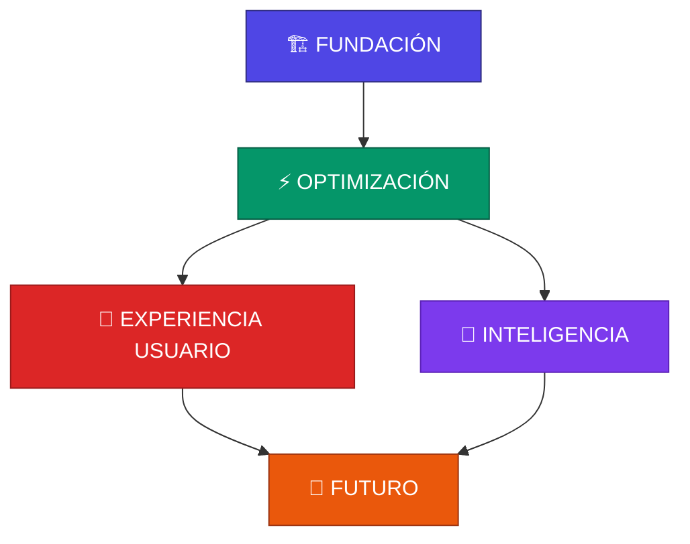

# 🗺️ ROADMAP MAESTRO - EP-BACK

> **Última actualización:** 2025-12-31  
> **Versión actual del sistema:** V2.0.0.0

## 📋 Índice de Roadmaps

Este documento es el **mapa maestro** que organiza todos los roadmaps del proyecto con sus dependencias y prioridades.



## 🎯 Niveles de Dependencia

### NIVEL 0: 🏗️ FUNDACIÓN (Prerequisitos para todo)
Roadmaps que **DEBEN** implementarse primero. Sin estos, el resto no tiene sentido.

| Roadmap | Archivo | Prioridad | Estado | Duración |
|---------|---------|-----------|--------|----------|
| Performance y Estabilidad | [roadmap_performance.md](file:///d:/EPPSaaS/ep-back/doc/Roadmap/roadmap_performance.md) | 🔴 CRÍTICA | Pendiente | Continuo |
| Mejoras de Firmas | [roadmap_firmas.md](file:///d:/EPPSaaS/ep-back/doc/Roadmap/roadmap_firmas.md) | 🔴 ALTA | Pendiente | 2-3 semanas |

**Justificación:** 
- Sin performance estable, cualquier feature nueva empeorará la experiencia
- Las firmas son core business del sistema actual

---

### NIVEL 1: ⚡ OPTIMIZACIÓN (Mejora la base)
Requiere: **NIVEL 0 completado al 70%**

| Roadmap | Archivo | Prerequisitos | Prioridad | Estado | Duración |
|---------|---------|---------------|-----------|--------|----------|
| Sistema PWA Offline | [roadmap_pwa_offline.md](file:///d:/EPPSaaS/ep-back/doc/Roadmap/roadmap_pwa_offline.md) | Performance estable | 🔴 ALTA | Pendiente | 3-4 semanas |
| Rediseño Sidebar | [roadmap_sidebar.md](file:///d:/EPPSaaS/ep-back/doc/Roadmap/roadmap_sidebar.md) | Ninguno | 🟡 MEDIA | Pendiente | 1-2 semanas |

**Justificación:**
- PWA offline es crítico para técnicos en campo (**valor inmediato**)
- Sidebar mejora UX pero no es bloqueante

---

### NIVEL 2: 📱 EXPERIENCIA USUARIO (Amplía funcionalidad)
Requiere: **NIVEL 1 completado**

| Roadmap | Archivo | Prerequisitos | Prioridad | Estado | Duración |
|---------|---------|---------------|-----------|--------|----------|
| Rol Usuarios Empresariales | [roadmap_usuarios_empresariales.md](file:///d:/EPPSaaS/ep-back/doc/Roadmap/roadmap_usuarios_empresariales.md) | Sistema estable + PWA opcional | 🟡 MEDIA | Pendiente | 3-4 semanas |

**Justificación:**
- Nuevos roles agregan complejidad, necesitan sistema estable
- PWA opcional pero recomendado (clientes móviles)

---

### NIVEL 3: 🤖 INTELIGENCIA (Automación inteligente)
Requiere: **NIVEL 1 completado**

| Roadmap | Archivo | Prerequisitos | Prioridad | Estado | Duración |
|---------|---------|---------------|-----------|--------|----------|
| IA y Automaciones | [roadmap_ia_automaciones.md](file:///d:/EPPSaaS/ep-back/doc/Roadmap/roadmap_ia_automaciones.md) | Performance + Data limpia | 🟢 BAJA | Exploratoria | 4-6 semanas |

**Justificación:**
- IA requiere datos de calidad (necesita sistema maduro)
- No es bloqueante pero agrega valor diferencial

---

### NIVEL 4: 🚀 FUTURO (Innovación)
Requiere: **NIVEL 2 y 3 completados**

| Roadmap | Archivo | Prerequisitos | Prioridad | Estado | Duración |
|---------|---------|---------------|-----------|--------|----------|
| App Móvil Nativa | [roadmap_app_movil.md](file:///d:/EPPSaaS/ep-back/doc/Roadmap/roadmap_app_movil.md) | PWA implementado + ROI validado | ⚪ MUY BAJA | Evaluación | 3-6 meses |
| Blockchain Certificados | [roadmap_blockchain.md](file:///d:/EPPSaaS/ep-back/doc/Roadmap/roadmap_blockchain.md) | Sistema completo + requerimiento legal | ⚪ MUY BAJA | Exploratoria | 6+ meses |

**Justificación:**
- Solo si PWA no cubre necesidades (evaluar en 6 meses)
- Blockchain solo si hay requerimiento legal o compliance

---

## 📊 Vista de Sprints Sugeridos

### 🎯 Sprint 1 (2-3 semanas) - FUNDACIÓN
**Tema:** Estabilidad y calidad base
- ✅ Implementar Laravel Pulse/Horizon
- ✅ Optimizar queries N+1
- ✅ Índices de base de datos
- ✅ Firmas SVG alta resolución
- ✅ Testing de carga inicial

**Criterio de éxito:**
- Tiempo de carga < 2s en todas las páginas
- 0 queries N+1 en rutas críticas
- Firmas legibles en PDFs

---

### 🎯 Sprint 2 (3-4 semanas) - PWA OFFLINE
**Tema:** Trabajo de campo sin internet
- ✅ Service Workers
- ✅ IndexedDB local storage
- ✅ Sincronización background
- ✅ Manifest PWA
- ✅ Testing offline

**Criterio de éxito:**
- Técnico puede completar 10 inspecciones offline
- Sincronización automática al regresar
- 0 pérdida de datos

**⚠️ Prerequisito:** Sprint 1 completado al 80%

---

### 🎯 Sprint 3 (1-2 semanas) - SIDEBAR UX
**Tema:** Navegación mejorada
- ✅ Rediseño agrupación lógica
- ✅ Menú colapsable por secciones
- ✅ Favoritos/accesos rápidos
- ✅ Búsqueda en sidebar

**Criterio de éxito:**
- Usuarios encuentran funciones 50% más rápido
- Menos de 3 clics a cualquier función

**⚠️ Prerequisito:** Ninguno (puede ejecutarse en paralelo)

---

### 🎯 Sprint 4 (3-4 semanas) - USUARIOS EMPRESARIALES
**Tema:** Portal para clientes
- ✅ Nuevo rol `usuario_empresarial`
- ✅ Pivot con empresas
- ✅ Dashboard cliente personalizado
- ✅ Permisos granulares
- ✅ Sistema de notificaciones/vistos

**Criterio de éxito:**
- Cliente ve solo sus empresas
- Notificación cuando técnico completa trabajo
- Acceso a todos los reportes/certificados

**⚠️ Prerequisito:** Sprint 1 completado + Sprint 2 recomendado

---

### 🎯 Sprint 5 (4-6 semanas) - IA FASE 1
**Tema:** Autocomplete inteligente
- ✅ Integración OpenAI API
- ✅ Sugerencias de respuestas checklist
- ✅ Análisis de imágenes (opcional)
- ✅ Generación de observaciones

**Criterio de éxito:**
- 70% de respuestas sugeridas correctamente
- Reduce tiempo de llenado en 30%

**⚠️ Prerequisito:** Sprint 1 + 2 completados, data histórica suficiente

---

## 🚦 Reglas de Dependencias

### Regla 1: No saltarse niveles
❌ **INCORRECTO:** Implementar Blockchain (NIVEL 4) sin PWA (NIVEL 1)  
✅ **CORRECTO:** Completar niveles secuencialmente

### Regla 2: Prerequisitos obligatorios
Cada roadmap especifica sus prerequisitos. **NO INICIAR** sin cumplirlos.

### Regla 3: Evaluación antes de NIVEL 4
Roadmaps de NIVEL 4 requieren **reunión de evaluación** antes de iniciar.

### Regla 4: Performance continuo
El roadmap de Performance es **siempre activo**, incluso después de Sprint 1.

---

## 📈 Métricas de Progreso

### Por Nivel
```
NIVEL 0 (Fundación):     [ ░░░░░░░░░░ ] 0%
NIVEL 1 (Optimización):  [ ░░░░░░░░░░ ] 0%
NIVEL 2 (UX):            [ BLOQUEADO   ]
NIVEL 3 (IA):            [ BLOQUEADO   ]
NIVEL 4 (Futuro):        [ BLOQUEADO   ]
```

### Por Roadmap
| Roadmap | Sprint | Completado | Bloqueado por |
|---------|--------|------------|---------------|
| Performance | 1 | 0% | - |
| Firmas | 1 | 0% | - |
| PWA Offline | 2 | 0% | Performance 80% |
| Sidebar | 3 | 0% | - |
| Usuarios Empresariales | 4 | 0% | Performance + PWA |
| IA | 5 | 0% | Performance + PWA + Data |
| App Móvil | - | 0% | PWA + ROI |
| Blockchain | - | 0% | Todo + Requerimiento |

---

## 🎬 Próximos Pasos

1. **Revisar y aprobar** este roadmap maestro
2. **Leer roadmap individual** de Sprint 1: [roadmap_performance.md](file:///d:/EPPSaaS/ep-back/doc/Roadmap/roadmap_performance.md)
3. **Iniciar Sprint 1** después de aprobación
4. **Actualizar métricas** semanalmente en este documento

---

## 📝 Notas de Actualización

| Fecha | Cambio | Autor |
|-------|--------|-------|
| 2025-12-31 | Creación inicial del roadmap maestro | IA |

---

> **💡 Filosofía:** "Fundamentos primero, innovación después. Cada feature debe construir sobre bases sólidas."
