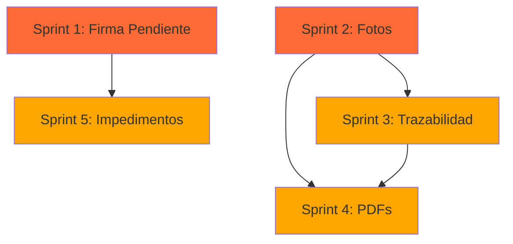

# Roadmap de Implementación - Sistema de Visitas

## Visión General

Este roadmap organiza las mejoras del sistema de visitas en sprints manejables, priorizando funcionalidades críticas y estableciendo dependencias claras.

---

## Sprint 1: Firma Pendiente (5 días) 🔴 CRÍTICO

### Objetivo
Permitir que visitas se finalicen sin firma del responsable, enviando email con link para firmar posteriormente.

### Tareas

#### Backend (2 días)
- [ ] Crear migración para campos de firma pendiente
- [ ] Actualizar modelo `VisitCertificate` con campos nuevos
- [ ] Modificar `VisitInProgress::finalizeVisit()` para manejar firma pendiente
- [ ] Crear `VisitSignatureController` con métodos:
  * `show($id, $token)` - Vista pública de firma
  * `store($id, $token)` - Guardar firma
- [ ] Crear `VisitSignatureNotification` (email)
- [ ] Configurar Mailtrap para testing

#### Frontend (2 días)
- [ ] Actualizar modal de finalización:
  * Checkbox "Firma pendiente"
  * Campo email del responsable
  * Validaciones
- [ ] Crear vista pública `/visits/{id}/sign/{token}`:
  * Mostrar resumen de visita
  * Canvas de firma (reutilizar código existente)
  * Botón confirmar
- [ ] Email template profesional con branding EP

#### Testing (1 día)
- [ ] Probar flujo completo: finalizar → email → firmar → PDF
- [ ] Validar token único y expiración
- [ ] Verificar regeneración de PDF con firma
- [ ] Test en móvil (firma touch)

### Criterios de Aceptación
✅ Técnico puede finalizar visita sin firma
✅ Email se envía automáticamente con link único
✅ Responsable puede firmar desde cualquier dispositivo
✅ PDF se actualiza con firma
✅ Estado cambia de `pending_signature` a `completed`

### Archivos a Crear/Modificar
```
database/migrations/
  └── xxxx_add_signature_pending_to_visits.php

app/
  ├── Http/Controllers/VisitSignatureController.php
  └── Notifications/VisitSignatureNotification.php

resources/views/
  ├── emails/visit-signature.blade.php
  └── public/visit-signature.blade.php

app/Livewire/Visits/VisitInProgress.php (modificar)
```

---

## Sprint 2: Fotos en Hallazgos/Incidentes (5 días) 🔴 CRÍTICO

### Objetivo
Permitir adjuntar hasta 5 fotos como evidencia en hallazgos e incidentes.

### Tareas

#### Backend (2 días)
- [ ] Crear migración para tabla `visit_photos`
- [ ] Crear modelo `VisitPhoto` con relaciones
- [ ] Configurar storage: `php artisan storage:link`
- [ ] Crear `VisitPhotoController`:
  * `store()` - Upload con validación
  * `destroy()` - Eliminar foto
- [ ] Implementar optimización de imágenes (Intervention Image)
- [ ] Validaciones: max 5 fotos, 5MB, jpg/png

#### Frontend (2 días)
- [ ] Componente Livewire `PhotoUploader`:
  * Drag & drop
  * Preview de fotos
  * Captura desde cámara (móvil)
  * Contador 5/5
- [ ] Integrar en modal de hallazgos
- [ ] Integrar en modal de incidentes
- [ ] Galería de fotos en vista de visita

#### PDF (1 día)
- [ ] Actualizar `visit-certificate.blade.php`:
  * Mostrar fotos en sección de hallazgos
  * Mostrar fotos en sección de incidentes
  * Thumbnails optimizados para PDF
- [ ] Probar tamaño de PDF con fotos

### Criterios de Aceptación
✅ Técnico puede subir fotos desde móvil/desktop
✅ Captura directa desde cámara funciona
✅ Máximo 5 fotos por hallazgo/incidente
✅ Fotos se optimizan automáticamente
✅ Fotos aparecen en PDF de constancia
✅ Galería funciona en vista de visita

### Archivos a Crear/Modificar
```
database/migrations/
  └── xxxx_create_visit_photos_table.php

app/
  ├── Models/VisitPhoto.php
  └── Http/Controllers/VisitPhotoController.php

app/Livewire/
  └── Components/PhotoUploader.php

resources/views/
  ├── livewire/components/photo-uploader.blade.php
  └── pdfs/visit-certificate.blade.php (modificar)
```

---

## Sprint 3: Trazabilidad de Hallazgos (4 días) 🟡 IMPORTANTE

### Objetivo
Sistema completo de seguimiento de hallazgos con asignación, plazos y resolución.

### Tareas

#### Backend (2 días)
- [ ] Crear migración para campos de trazabilidad
- [ ] Actualizar modelo `Hallazgo`:
  * Relación con usuario asignado
  * Relación con visita de seguimiento
  * Scope para pendientes/vencidos
- [ ] Observer para calcular `due_date` automáticamente
- [ ] Notificaciones de vencimiento

#### Dashboard Gestor (1.5 días)
- [ ] Vista de hallazgos pendientes
- [ ] Filtros: severidad, estado, vencimiento
- [ ] Asignación de hallazgo a técnico
- [ ] Vista de detalle con historial

#### Resolución (0.5 días)
- [ ] Modal de resolución:
  * Notas de resolución
  * Adjuntar evidencia (fotos)
  * Vincular a visita de seguimiento

### Criterios de Aceptación
✅ `due_date` se calcula automáticamente (7/15/30 días)
✅ Gestor ve dashboard de hallazgos pendientes
✅ Puede asignar hallazgo a técnico
✅ Técnico recibe notificación
✅ Técnico puede marcar como resuelto
✅ Historial completo de cada hallazgo

### Archivos a Crear/Modificar
```
database/migrations/
  └── xxxx_add_traceability_to_hallazgos.php

app/
  ├── Models/Hallazgo.php (modificar)
  ├── Observers/HallazgoObserver.php
  └── Notifications/HallazgoAssignedNotification.php

app/Livewire/Gestor/
  ├── HallazgosDashboard.php
  └── HallazgoDetail.php
```

---

## Sprint 4: Normalización de PDFs (4 días) 🟡 IMPORTANTE

### Objetivo
Unificar diseño de todos los PDFs con colores EP y componentes reutilizables.

### Tareas

#### Estructura Base (1 día)
- [ ] Crear `resources/views/pdf/layouts/base.blade.php`
- [ ] CSS compartido con variables EP
- [ ] Componentes reutilizables:
  * Header con logo dinámico
  * Footer estándar
  * Badges de estado
  * Info grids

#### Actualizar PDFs Existentes (2 días)
- [ ] `training-attendance.blade.php` (ya está bien, revisar)
- [ ] `epp-delivery.blade.php`
- [ ] `hallazgo-report.blade.php`
- [ ] `inspection.blade.php`
- [ ] Implementar logo dinámico en todos

#### Constancia de Visita Detallada (1 día)
- [ ] Rediseñar `visit-certificate.blade.php`:
  * Portada con resumen ejecutivo
  * Desglose detallado de checklists
  * Lista de asistentes en capacitaciones
  * Tabla completa de entregas EPP
  * Hallazgos con acciones correctivas
  * Firmas al final

### Criterios de Aceptación
✅ Todos los PDFs usan colores EP consistentes
✅ Logo dinámico funciona (preparado para multi-tenant)
✅ Componentes reutilizables en todos los PDFs
✅ Constancia de visita muestra detalles completos
✅ PDFs se ven profesionales en impresión

### Archivos a Crear/Modificar
```
resources/views/pdf/
  ├── layouts/
  │   └── base.blade.php
  ├── components/
  │   ├── header.blade.php
  │   ├── footer.blade.php
  │   └── badges.blade.php
  └── visit-certificate.blade.php (rediseñar)
```

---

## Sprint 5: Campo de Impedimentos (2 días) 🟡 IMPORTANTE

### Objetivo
Permitir justificar visitas sin actividades completadas.

### Tareas

#### Backend (0.5 días)
- [ ] Migración para campos de impedimentos
- [ ] Actualizar validación de finalización

#### Frontend (1 día)
- [ ] Actualizar modal de finalización:
  * Checkbox "Hubo impedimentos"
  * Textarea para descripción
  * Permitir finalizar sin actividades si hay impedimentos

#### PDF (0.5 días)
- [ ] Mostrar impedimentos en constancia si existen
- [ ] Sección destacada con explicación

### Criterios de Aceptación
✅ Técnico puede marcar impedimentos
✅ Puede finalizar visita sin actividades si justifica
✅ Impedimentos aparecen en PDF
✅ Reportes de impedimentos frecuentes (futuro)

---

## Preparación Futura (No Implementar Ahora)

### Geolocalización
- [ ] Agregar campos a BD (hacer ahora)
- [ ] Implementar captura GPS (después)
- [ ] Validación de proximidad (después)

### Checklists Obligatorios
- [ ] Investigar checklists más usados
- [ ] Definir criterios de obligatoriedad
- [ ] Implementar validación

### Logos Personalizados
- [ ] Capa super admin
- [ ] Upload de logos por empresa
- [ ] Colores personalizados por empresa

---

## Cronograma General

```
Semana 1-2: Sprint 1 (Firma Pendiente)
Semana 3-4: Sprint 2 (Fotos)
Semana 5: Sprint 3 (Trazabilidad)
Semana 6: Sprint 4 (PDFs)
Semana 7: Sprint 5 (Impedimentos)
```

**Total estimado: 7 semanas (1.5 meses)**

---

## Dependencias



**Crítico (Rojo)**: Sprint 1 y 2 pueden hacerse en paralelo
**Importante (Naranja)**: Sprint 3, 4 y 5 dependen de los críticos

---

## Notas de Implementación

### Configuración Inicial
```bash
# Mailtrap para emails
MAIL_MAILER=smtp
MAIL_HOST=smtp.mailtrap.io
MAIL_PORT=2525

# Storage para fotos
php artisan storage:link

# Intervention Image
composer require intervention/image
```

### Migraciones a Crear
1. `add_signature_pending_to_visits.php`
2. `create_visit_photos_table.php`
3. `add_traceability_to_hallazgos.php`
4. `add_impediments_to_visits.php`
5. `add_geolocation_to_visits.php` (preparación)

### Testing
- Cada sprint debe tener tests funcionales
- Probar en móvil (firma, fotos, cámara)
- Validar PDFs en impresión física
- Performance con muchas fotos

---

## Criterios de Éxito del Proyecto

✅ **Firma pendiente**: 90% de visitas finalizadas (con o sin firma)
✅ **Fotos**: 80% de hallazgos con evidencia fotográfica
✅ **Trazabilidad**: 0 hallazgos sin seguimiento
✅ **PDFs**: 100% de PDFs con diseño consistente
✅ **Impedimentos**: Reducción de visitas "sin actividades" sin justificación

---

## Próximos Pasos Inmediatos

1. ✅ Aprobar este roadmap
2. 🔄 Crear rama: `feature/visit-improvements`
3. 🚀 Iniciar Sprint 1: Firma Pendiente
4. 📝 Daily updates en task.md
5. 🎯 Demo al final de cada sprint
