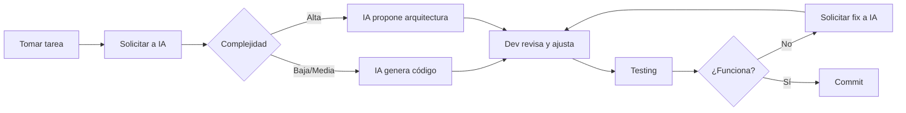
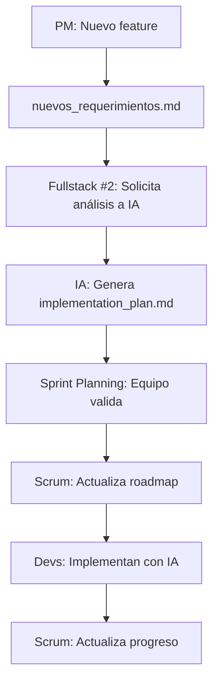

# 🚀 WORKFLOW DE DESARROLLO - EP-BACK
## AI-Assisted Agile Development

> **Versión:** 1.0  
> **Fecha:** 2025-12-31  
> **Equipo:** 1 PM + 1 Scrum Master + 2 Fullstack Developers + IA

---

## 👥 Composición del Equipo

| Rol | Responsabilidad Principal | Interacción con IA |
|-----|---------------------------|-------------------|
| **Product Manager (PM)** | Definir features, priorizar roadmap, validar entregas | Define requerimientos en `nuevos_requerimientos.md` |
| **Scrum Master** | Facilitar ceremonias, remover bloqueos, métricas | Actualiza progreso en roadmaps, gestiona sprints |
| **Fullstack Developer #1** | Features standard, UI/UX, integraciones | Implementa código con asistencia IA |
| **Fullstack Developer #2** | Complejidades altas, deployment, BD, arquitectura | Revisa arquitectura propuesta por IA, ejecuta deploys |

---

## 🔄 Nuevo Ciclo de Desarrollo

### Fase 0: Descubrimiento (Async)

**Duración:** Continuo

**Responsables:** PM + Scrum

**Proceso:**
1. PM identifica nuevo requerimiento o mejora
2. PM documenta en `doc/Desarrollos/nuevos_requerimientos.md`
3. PM puede hacer preguntas técnicas en `doc/Desarrollos/banco_de_preguntas.md`
4. IA analiza y responde con opciones técnicas
5. PM valida viabilidad antes de sprint planning

**Output:** Requerimiento documentado + análisis técnico inicial

---

### Fase 1: Planning con IA (Sprint Planning)

**Duración:** 2-3 horas (antes eran 4-6 horas)

**Participantes:** Todo el equipo + IA

**Nuevo flujo:**

#### 1.1 Pre-Planning (1 hora antes, solo Fullstack #2 + IA)
```
Fullstack #2 solicita a IA:
- Analizar nuevos requerimientos
- Proponer arquitectura técnica
- Identificar dependencias
- Estimar complejidad

IA genera:
- implementation_plan.md
- Roadmap individual (si aplica)
- Actualización de ROADMAP_MAESTRO.md
```

#### 1.2 Planning Meeting (1.5 horas)
```
09:00 - 09:15 | PM presenta features priorizados
09:15 - 09:45 | Fullstack #2 presenta plan técnico de IA
              | Equipo debate y ajusta
09:45 - 10:15 | Estimación de story points
              | Asignación de tareas
10:15 - 10:30 | Scrum define Sprint Goal y métricas
```

**Output:** Sprint backlog + roadmap actualizado

---

### Fase 2: Desarrollo Asistido por IA (Durante Sprint)

**Duración:** 2-3 semanas (antes eran 3-4 semanas)

#### Workflow diario por Developer:



#### Distribución de trabajo:

**Fullstack #1** (Standard):
- UI/UX components
- CRUD operations
- Integraciones simples
- Livewire components
- Usa IA para: generación de código, debugging, optimizaciones

**Fullstack #2** (Complejo):
- Arquitectura de BD
- Optimizaciones de performance
- Migraciones complejas
- Deployment
- Usa IA para: análisis de arquitectura, propuestas de optimización, review de código

---

### Fase 3: Review Continuo (Martes y Jueves)

**Duración:** 30 min (antes eran 1 hora)

**Participantes:** Todo el equipo

**Proceso:**
```
15:00 - 15:10 | Cada dev muestra progreso
15:10 - 15:20 | Demo de features completados
15:20 - 15:30 | PM valida vs requerimientos
```

**Clave:** Reviews más frecuentes pero más cortas = menos sorpresas

---

### Fase 4: Retrospectiva con Métricas IA (Fin de Sprint)

**Duración:** 1 hora

**Nuevas métricas a trackear:**

| Métrica | Cómo medirla |
|---------|--------------|
| **Velocidad con IA** | Story points / sprint (comparar con histórico sin IA) |
| **Precisión de IA** | % de código generado por IA usado sin cambios |
| **Time to Market** | Días desde requerimiento a producción |
| **Calidad** | Bugs post-deploy (debe mantenerse o mejorar) |
| **Adopción de IA** | % de tareas donde se usó IA |

**Formato:**
```
16:00 - 16:15 | ¿Qué salió bien?
              | Ejemplo: "IA generó PWA en 2 días vs 2 semanas"
              
16:15 - 16:30 | ¿Qué mejorar?
              | Ejemplo: "IA alucinó con validaciones, perdimos 3 horas"
              
16:30 - 16:45 | Acciones para próximo sprint
              | Ejemplo: "Especificar validaciones en prompts"
              
16:45 - 17:00 | Actualizar workflows.md si es necesario
```

---

## 📋 Ceremonias Actualizadas

### Daily Standup (15 min - sin cambios)
- ¿Qué hice ayer?
- ¿Qué haré hoy?
- ¿Bloqueadores?

### Sprint Planning (1.5h - REDUCIDO de 4h)
- Pre-planning con IA reduce tiempo de debate técnico

### Sprint Review (30min x 2/semana - NUEVO)
- Antes: 1 review al final (2h)
- Ahora: 2 reviews mid-sprint (30min c/u)
- Beneficio: Detectar problemas antes

### Retrospectiva (1h - sin cambios)
- Agregar métricas de IA

---

## 🎯 Responsabilidades por Rol

### Product Manager

**Con IA:**
- ✅ Documentar requerimientos en formato claro
- ✅ Consultar viabilidad técnica a IA antes de priorizar
- ✅ Validar que implementation plans cumplen business goals

**Sin IA (antes):**
- ❌ Esperar a planning para saber si algo es viable
- ❌ Sorpresas técnicas mid-sprint

---

### Scrum Master

**Con IA:**
- ✅ Actualizar progreso en roadmaps semanalmente
- ✅ Detectar dependencias bloqueadas (IA avisa)
- ✅ Facilitar adopción de IA en equipo
- ✅ Trackear métricas de velocidad con/sin IA

**Nuevas responsabilidades:**
- Asegurar que documentación se mantiene actualizada
- Evangelizar mejores prácticas con IA

---

### Fullstack Developer #1

**Con IA:**
- ✅ Solicitar código base
- ✅ Iterar con IA para ajustes
- ✅ Enfocarse en lógica de negocio (IA maneja boilerplate)
- ✅ Testing y validación

**Tiempo ganado:**
- Antes: 60% código repetitivo, 40% lógica
- Ahora: 20% código repetitivo, 80% lógica

---

### Fullstack Developer #2

**Con IA:**
- ✅ Revisar arquitecturas propuestas por IA
- ✅ Validar migrations y esquemas de BD
- ✅ Optimizar queries sugeridos por IA
- ✅ Deployments y CI/CD

**Nuevo rol clave:**
- Arquitecto que valida propuestas de IA
- Mentor de Fullstack #1 en uso avanzado de IA

---

## 🛠️ Herramientas y Documentos

### Documentos clave en `/doc`:

```
doc/
├── Roadmap/
│   ├── ROADMAP_MAESTRO.md          ← Scrum actualiza progreso
│   └── roadmap_*.md                ← Por feature
├── Desarrollos/
│   ├── nuevos_requerimientos.md    ← PM documenta aquí
│   └── banco_de_preguntas.md       ← PM/Devs preguntan a IA
└── WORKFLOW.md                     ← Este documento
```

### Flujo de documentos:



---

## 📊 Métricas de Éxito del Nuevo Workflow

### Comparativa (estimada):

| Métrica | Sin IA (Antes) | Con IA (Ahora) | Mejora |
|---------|----------------|----------------|--------|
| **Sprint Planning** | 4-6 horas | 1.5 horas | 70% ⬇️ |
| **Duración Sprint** | 3-4 semanas | 2-3 semanas | 33% ⬇️ |
| **Código por dev/día** | 100-150 líneas | 300-500 líneas | 250% ⬆️ |
| **Time to market** | 2-3 meses | 3-6 semanas | 50% ⬇️ |
| **Bugs post-deploy** | Baseline | ≤ Baseline | Mantener |

### KPIs a trackear mensualmente:

1. **Velocity trend** (story points/sprint)
2. **Lead time** (días desde backlog a producción)
3. **Code quality** (bugs, cobertura de tests)
4. **Team satisfaction** (encuesta 1-5)
5. **AI adoption rate** (% tareas con IA)

---

## ⚠️ Riesgos y Mitigaciones

### Riesgo 1: Dependencia excesiva de IA
**Mitigación:**
- Revisión obligatoria de todo código generado
- Pair programming en features críticos
- Fullstack #2 valida arquitectura siempre

### Riesgo 2: Calidad del código
**Mitigación:**
- Testing obligatorio (manual + automatizado)
- Code review entre devs
- IA no hace deploy, solo Fullstack #2

### Riesgo 3: Documentación desactualizada
**Mitigación:**
- Scrum actualiza roadmaps semanalmente
- Sprint retrospective incluye review de docs
- IA ayuda a mantener docs actualizados

### Riesgo 4: Curva de aprendizaje
**Mitigación:**
- Fullstack #2 mentoriza a Fullstack #1
- Compartir mejores prompts en retrospectivas
- Documentar patterns que funcionan

---

## 🎓 Mejores Prácticas

### Para PM:
1. ✅ Documentar requerimientos claros con casos de uso
2. ✅ Consultar IA antes de priorizar (viabilidad técnica)
3. ✅ Validar demos frecuentemente (no esperar al final)

### Para Scrum:
1. ✅ Mantener roadmaps actualizados (transparencia)
2. ✅ Facilitar retrospectivas con foco en IA
3. ✅ Trackear métricas de velocidad

### Para Fullstack #1:
1. ✅ Ser específico en prompts a IA
2. ✅ SIEMPRE revisar código generado
3. ✅ Hacer testing exhaustivo
4. ✅ Compartir hallazgos con equipo

### Para Fullstack #2:
1. ✅ Validar arquitecturas propuestas por IA
2. ✅ Optimizar código crítico
3. ✅ Mentoría en uso avanzado de IA
4. ✅ Ownership de deployment y BD

---

## 🚀 Próximos Pasos para Adopción

### Semana 1: Alineamiento
- [ ] Reunión de equipo para presentar nuevo workflow
- [ ] Asignar responsabilidades actualizadas
- [ ] Configurar acceso a IA para todos

### Semana 2: Piloto
- [ ] Primer sprint con nuevo workflow
- [ ] Trackear métricas baseline
- [ ] Daily check-ins de adopción

### Semana 3-4: Iteración
- [ ] Retrospectiva especial sobre workflow
- [ ] Ajustar según feedback
- [ ] Documentar learnings

### Mes 2+: Business as Usual
- [ ] Workflow integrado
- [ ] Métricas regulares
- [ ] Mejora continua

---

## 📝 Changelog del Workflow

| Fecha | Versión | Cambios |
|-------|---------|---------|
| 2025-12-31 | 1.0 | Creación inicial del workflow con IA |

---

## 💬 Feedback y Mejoras

Este workflow es **vivo y debe evolucionar**.

**¿Cómo sugerir cambios?**
1. Levantar en retrospectiva
2. Documentar en issue/canal de equipo
3. Validar con equipo completo
4. Actualizar este documento

**Responsable de mantener actualizado:** Scrum Master

---

> **💡 Filosofía:** "La IA es un multiplicador de fuerza, no un reemplazo. El criterio humano siempre tiene la última palabra."
