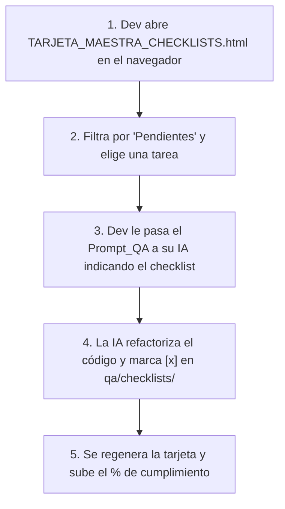

# 🤖 Guía y Prompt de QA para el Equipo de Desarrollo

Este documento está diseñado para que los desarrolladores y sus asistentes de Inteligencia Artificial (Cursor, Claude Code, GitHub Copilot, Gemini, etc.) sepan exactamente cómo trabajar con el sistema de calidad, auditar y resolver los puntos pendientes.

---

## 💡 ¿Cómo se complementan la Tarjeta HTML y los Checklists Markdown?

* **Para el Desarrollador (Humano):**
  Abrí con doble clic en tu navegador [**`qa/informes/generados/TARJETA_MAESTRA_CHECKLISTS.html`**](file:///d:/ep-back/qa/informes/generados/TARJETA_MAESTRA_CHECKLISTS.html).
  Es tu **tablero visual interactivo**: podés filtrar por *"Pendientes"*, ver el diagnóstico de líneas de código (LOC), vistas monolíticas y elegir qué tarjeta o punto querés abordar.

* **Para la Inteligencia Artificial (Agente de Código):**
  **Mandala a leer los archivos Markdown en [`qa/checklists/`](file:///d:/ep-back/qa/checklists)** (`01-seguridad.md` a `10-documentacion.md`).
  Para un modelo de lenguaje, el Markdown es la fuente de verdad directa, rápida y sin ruido de diseño HTML. Además, la IA puede marcar con `[x]` los puntos a medida que los resuelva en el código.

---

## 📋 Prompt para pasarle a tu Asistente de IA

> **Instrucciones para el desarrollador:**  
> Copiá el bloque de abajo, completá el área o punto que elegiste en la tarjeta visual y pegáselo a tu IA en la raíz del proyecto.

```markdown
Actuá como desarrollador senior de este proyecto: HSE SaaS (XamaSafe / EP-Back) (Stack: PHP 8.5 / Laravel 12.44 + React 19.2.5 + Inertia.js 3.0.3 + Tailwind CSS 4.0 + SQLite/MySQL Eloquent ORM).

Tu objetivo es resolver los requerimientos técnicos de QA asignados.

### 1. FUENTE DE VERDAD
Leé el archivo de checklist correspondiente en `qa/checklists/`:
- `qa/checklists/01-seguridad.md`
- `qa/checklists/02-backend-laravel.md`
- `qa/checklists/03-frontend-react-inertia.md`
- `qa/checklists/04-base-de-datos-eloquent.md`
- `qa/checklists/05-api-inertia-sanctum.md`
- `qa/checklists/06-testing.md`
- `qa/checklists/07-legacy-y-limpieza.md`
- `qa/checklists/08-deploy-y-entorno.md`
- `qa/checklists/09-control-de-versiones.md`
- `qa/checklists/10-documentacion.md`

### 2. TAREA A RESOLVER
Quiero que resuelvas el/los siguiente(s) punto(s):
👉 [ESCRIBÍ ACÁ EL ÍTEM O PUNTOS QUE QUERÉS RESOLVER, O "Revisá todo el archivo 0X-..."]

### 3. REGLAS ESTRICTAS DE IMPLEMENTACIÓN
1. **No inventar ni romper compatibilidad:** Mantené el estilo de código del proyecto (HUD táctico oscuro en React + Tailwind v4), la tipificación estricta en PHP y los contratos de Inertia/Ziggy existentes.
2. **Controladores Delgados en Backend:** Los controladores deben ser delgados (< 200 líneas). Evitá acumular consultas Eloquent complejas o `DB::transaction` en un Controller; encapsulalas en `app/Services/` y las validaciones en `app/Http/Requests/`.
3. **Modularidad en Frontend:** Ninguna vista o página en `resources/js/Pages/` debe ser un monolito (> 500 líneas). Si agregás o refactorizás lógica extensa, extraé subcomponentes en `Partials/` o `Components/`.
4. **Verificación:** Si modificás backend o frontend, asegurate de que no queden errores de sintaxis PHP, referencias rotas ni fallos en `npm run build`.

### 4. CIERRE Y ACTUALIZACIÓN
Una vez que el código esté corregido y verificado:
1. Mostrame un resumen conciso de los archivos modificados y la solución aplicada.
2. Editá el checklist en `qa/checklists/` cambiando `- [ ]` a `- [x]` únicamente en los ítems que hayan quedado 100% resueltos en el código.
```

---

## 🔄 Flujo de Trabajo Recomendado (Paso a Paso)



1. **Elegir:** El dev abre `TARJETA_MAESTRA_CHECKLISTS.html` y ve qué falta y qué archivos superan los límites de líneas.
2. **Instruir:** Le pasa a su IA el prompt indicando el checklist de `qa/checklists/`.
3. **Resolver:** La IA aplica los cambios en el código real respetando las reglas de arquitectura y modularidad.
4. **Tildar:** La IA pasa el ítem a `- [x]` en el archivo Markdown correspondiente.
5. **Verificar avance:** Cada vez que se actualizan los checklists, la tarjeta ejecutiva refleja el nuevo porcentaje de éxito del equipo.
